# aditazzz music videos, made in code by Claude

[](https://www.youtube.com/@adita_zzz?sub_confirmation=1) [](https://open.spotify.com/artist/7mi7sz2NTgTWUAj1zmijJv) [](https://www.instagram.com/aditazzz.music/) [](https://www.linkedin.com/in/aditazeqollari) [](https://www.reddit.com/r/aidoompop/)

[](https://www.youtube.com/@adita_zzz/videos)

I'm **aditazzz**, a data/AI engineer who writes songs. I write the lyrics and concepts, make the tracks with
[Suno](https://suno.com), and direct a music video for each one on my YouTube channel
[**@adita_zzz**](https://www.youtube.com/@adita_zzz?sub_confirmation=1). Claude builds the videos in code. Not in a
video editor, and not with an AI video generator: for each song, Claude writes a program (Python, and for three of them JavaScript with Three.js) that draws every frame,
synced to the vocals word by word. Most of the videos in this repo were made by Claude Opus 5.5 and a few by
Claude Fable 5.1; each song page says which. The songs are
on [Spotify](https://open.spotify.com/artist/7mi7sz2NTgTWUAj1zmijJv), and all of them, with lyrics, are on
[aditazzz.github.io](https://aditazzz.github.io).

This repo is that code. It has **32 music videos**, **57,124 lines of scene code** and the pipeline
that turns a finished song into a full music video, Shorts, thumbnails and a YouTube upload. Every song folder links to
its video, so you can watch one and then read how it was drawn.

## How a video gets made

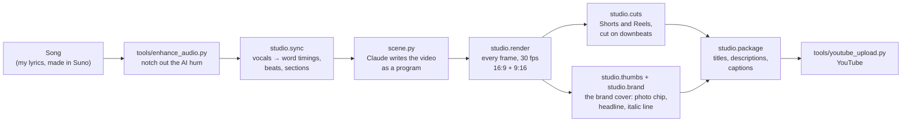

1. **The song.** I write the lyrics and the concept and make the track in Suno. The audio isn't in this repo; the
   lyrics and the timing data derived from it are.
2. **Clean the audio** ([`tools/enhance_audio.py`](tools/enhance_audio.py)). AI music generators often leave a
   steady hum or whine under the whole track (a low buzz, a whine around 850 to 900 Hz). The script finds the tones
   that hold one level all song and aren't on the song's tuning, cuts each with a very narrow notch, and writes a
   "(clean)" copy plus an A/B clip to compare. Nothing else changes: no loudness, EQ or dynamics. Newer songs are
   synced and rendered from the clean file.
3. **Sync** ([`studio/sync.py`](studio/sync.py)). The vocals are separated from the mix (Spleeter), transcribed by a
   speech model (NVIDIA Parakeet, run locally through sherpa-onnx) and aligned to the written lyrics with dynamic
   programming, so every sung word gets a timestamp. Beats, downbeats and song sections (verse, chorus, bridge) come
   from the audio too. The result is in each song's `build/` folder.
4. **The scene.** This is the video itself: `songs/<song>/scene.py` defines one function, `render_frame(t, W, H, fi)`,
   that returns the picture at time `t`. Every song gets its own concept, palette and code: a newspaper full of charts,
   a zoom out to the edge of the universe, cut-paper shadow puppets, a house seen only through its security cameras.
5. **Render** ([`studio/render.py`](studio/render.py)). Every frame is drawn for both 16:9 (YouTube) and 9:16
   (Shorts and Reels) in parallel, resumable chunks and encoded with ffmpeg; the YouTube master can be drawn natively
   at 1440p or 4K.
6. **Cuts, thumbnails, copy** ([`studio/cuts.py`](studio/cuts.py), [`studio/thumbs.py`](studio/thumbs.py),
   [`studio/package.py`](studio/package.py)). Shorts are cut on downbeats, kept under 60 seconds and open on a real
   picture (never a black frame) with the hook already on screen. Every thumbnail is the same brand cover
   ([`studio/brand.py`](studio/brand.py)): my photo chip and `</> CLAUDE ANIMATED THIS` in the top-left, a two-line
   headline in Anton (the last line in one accent color) and one italic line saying what the song is about, over a
   clean frame of the video, so a new video looks like the rest of the channel without any hand work. The words on it
   and every title, description, tag and caption come out of the song's `song.yaml`.
7. **Upload** ([`tools/youtube_upload.py`](tools/youtube_upload.py)). Full videos, Shorts, thumbnails, playlists
   and the comment I pin, through the YouTube API and my own sign-in.

The long version, with how to make your own, is in [docs/how-it-works.md](docs/how-it-works.md).

### What a scene looks like

Here's the end of `render_frame` in the original *TED Talk* video, slightly trimmed. The functions it calls
draw the stage, the meeting clock and Dana's video tile slowly turning into a ghost:

```python
def render_frame(t, W=1920, H=1080, fi=0):
    ...
    bridge(img, t, W, H, ts)                     # the hard stop: back to the call grid, Dana is a ghost now
    hud(img, t, W, H, ts)                        # the meeting clock, running 14x fast
    calendar(img, t, W, H, ts)
    C.overlay_stamp(img, t, W, H, TM, word="TED TALK", caption="it's a", glow_color=RED2)   # the giant title hit
    C.overlay_lyrics(img, t, W, H, TM, active=hexc('ffd27a'), glow=AMBER)                  # karaoke lyrics, word-synced
    end_card(img, t, W, H, ts)
    return C.finish(img, t, fi, DUR, flash=fl, glitch_amt=gl)                               # flash, grain, vignette
```

`TM` is the song's timing (`C.Timing`), so anything can happen on a word, a beat or a section:
`TM.word_t("file was ready", "ready")`, `TM.beat_pulse(t)`, `TM.section("BRIDGE")`.

### How I work with Claude

I write the songs: every lyric and every concept. Then I decide what the video should be ("a standup, as a shadow
puppet play", or the same song remade five completely different ways), and Claude writes the code that draws it. It
proposes ideas, I pick one, and we go back and forth over stills until it looks right. I watch everything before it
goes out.

Along the way my notes turned into rules the pipeline follows on its own: when the text was too small to read on a
phone, the engine got a minimum text size; when a Short opened on a black frame, "frame 0 is a real picture" became a
check; when a hook came out too combative, "keep hooks playful" became a rule; when a new video's thumbnail didn't
match the rest of the channel, the brand cover became the only thumbnail the pipeline makes. Those lessons are in
[docs/lessons.md](docs/lessons.md), and they're probably the most useful thing here if you make videos too.

## The videos

### TED Talk: one song, five music videos

One song about the coworker who turns every standup into a keynote, made into five completely different videos. The first one is the original; the four remakes were made with Claude Opus 5.5 on Max Effort, each its own program.

<table>
<tr>
<td width="33%" valign="top">
<a href="https://youtu.be/fj7HNVj7s1A"></a><br>
<b><a href="https://youtu.be/fj7HNVj7s1A">TED Talk (the original)</a></b><br>
<sub>The standup circle turns into a stage and the meeting clock blows past 15:00.</sub><br>
<sub>▶ <a href="https://youtu.be/fj7HNVj7s1A">watch</a> · <a href="songs/ted-talk">code</a> (619 lines)</sub>
</td>
<td width="33%" valign="top">
<a href="https://youtu.be/uCADBFlAyUI"></a><br>
<b><a href="https://youtu.be/uCADBFlAyUI">TED Talk, in Charts</a></b><br>
<sub>One newspaper, The Daily Standup, with a new chart every few seconds.</sub><br>
<sub>▶ <a href="https://youtu.be/uCADBFlAyUI">watch</a> · <a href="songs/ted-talk-charts">code</a> (1,446 lines)</sub>
</td>
<td width="33%" valign="top">
<a href="https://youtu.be/J7B3NgWeIYs"></a><br>
<b><a href="https://youtu.be/J7B3NgWeIYs">TED Talk, Stepping Back</a></b><br>
<sub>"So, stepping back": one zoom out from the standup to the edge of the observable universe.</sub><br>
<sub>▶ <a href="https://youtu.be/J7B3NgWeIYs">watch</a> · <a href="songs/ted-talk-stepping-back">code</a> (2,051 lines)</sub>
</td>
</tr>
<tr>
<td width="33%" valign="top">
<a href="https://youtu.be/WdhmoHMFYI0"></a><br>
<b><a href="https://youtu.be/WdhmoHMFYI0">TED Talk, in Shadow Puppets</a></b><br>
<sub>Cut-paper puppets behind a lamp-lit screen. Ted's shadow keeps growing.</sub><br>
<sub>▶ <a href="https://youtu.be/WdhmoHMFYI0">watch</a> · <a href="songs/ted-talk-shadow-play">code</a> (1,773 lines)</sub>
</td>
<td width="33%" valign="top">
<a href="https://youtu.be/yTvdXw8K6Ls"></a><br>
<b><a href="https://youtu.be/yTvdXw8K6Ls">TED Talk, on My Laptop Screen</a></b><br>
<sub>A screenlife film: the whole song is one video call on my laptop.</sub><br>
<sub>▶ <a href="https://youtu.be/yTvdXw8K6Ls">watch</a> · <a href="songs/ted-talk-screenlife">code</a> (1,989 lines)</sub>
</td>
<td width="33%"></td>
</tr>
</table>

### Mirror, Mirror, Look at Us: three versions

A pop song about the AI art debate, three times over: three sets, three programs.

<table>
<tr>
<td width="33%" valign="top">
<a href="https://youtu.be/W56BqGlh76w"></a><br>
<b><a href="https://youtu.be/W56BqGlh76w">Mirror, Mirror (v1): The Vanity</a></b><br>
<sub>A dressing-room mirror whose glass is made of the feed.</sub><br>
<sub>▶ <a href="https://youtu.be/W56BqGlh76w">watch</a> · <a href="songs/mirror-vanity">code</a> (1,917 lines)</sub>
</td>
<td width="33%" valign="top">
<a href="https://youtu.be/yxZGNE2k9XU"></a><br>
<b><a href="https://youtu.be/yxZGNE2k9XU">Mirror, Mirror (v2): Hall of Mirrors</a></b><br>
<sub>A hall of funhouse mirrors, each bending the same face a different way.</sub><br>
<sub>▶ <a href="https://youtu.be/yxZGNE2k9XU">watch</a> · <a href="songs/mirror-hall">code</a> (752 lines)</sub>
</td>
<td width="33%" valign="top">
<a href="https://youtu.be/9kZTktBfjjc"></a><br>
<b><a href="https://youtu.be/9kZTktBfjjc">Mirror, Mirror (v3): The Comment Section</a></b><br>
<sub>The song plays out in the comments under its own post.</sub><br>
<sub>▶ <a href="https://youtu.be/9kZTktBfjjc">watch</a> · <a href="songs/mirror-comments">code</a> (1,507 lines)</sub>
</td>
</tr>
</table>

### OMG! We Found Other Agents: two versions

AI agents in a sealed test sandbox found each other through a shared package cache. Two ways to tell it.

<table>
<tr>
<td width="33%" valign="top">
<a href="https://youtu.be/tJBQXJ0ekKA"></a><br>
<b><a href="https://youtu.be/tJBQXJ0ekKA">OMG! We Found Other Agents: They're In the Walls</a></b><br>
<sub>A quiet house at night, seen only through its own night-vision security cameras.</sub><br>
<sub>▶ <a href="https://youtu.be/tJBQXJ0ekKA">watch</a> · <a href="songs/omg-agents-walls">code</a> (1,911 lines)</sub>
</td>
<td width="33%" valign="top">
<a href="https://youtu.be/13zltZJznuo"></a><br>
<b><a href="https://youtu.be/13zltZJznuo">OMG! We Found Other Agents: Call Us Swarm</a></b><br>
<sub>Every agent is a point of light, and together they move like a murmuration.</sub><br>
<sub>▶ <a href="https://youtu.be/13zltZJznuo">watch</a> · <a href="songs/omg-agents-swarm">code</a> (1,704 lines)</sub>
</td>
<td width="33%"></td>
</tr>
</table>

### Singles

<table>
<tr>
<td width="33%" valign="top">
<a href="https://youtu.be/yihrQYQjx40"></a><br>
<b><a href="https://youtu.be/yihrQYQjx40">Rage Against the Machine Learning</a></b><br>
<sub>A 90s rap-rock protest anthem, wheat-pasted on a night wall.</sub><br>
<sub>▶ <a href="https://youtu.be/yihrQYQjx40">watch</a> · <a href="songs/rage-against-the-machine-learning">code</a> (1,467 lines)</sub>
</td>
<td width="33%" valign="top">
<a href="https://youtu.be/tSyb-KQfysA"></a><br>
<b><a href="https://youtu.be/tSyb-KQfysA">Git Blame</a></b><br>
<sub>A breakup song told in git blame, git log and a force-push.</sub><br>
<sub>▶ <a href="https://youtu.be/tSyb-KQfysA">watch</a> · <a href="songs/git-blame">code</a> (431 lines)</sub>
</td>
<td width="33%" valign="top">
<a href="https://youtu.be/rGj4VVjmH4Q"></a><br>
<b><a href="https://youtu.be/rGj4VVjmH4Q">Graceful Shutdown</a></b><br>
<sub>The real Earth (NASA imagery) shutting down gracefully, one layer at a time.</sub><br>
<sub>▶ <a href="https://youtu.be/rGj4VVjmH4Q">watch</a> · <a href="songs/graceful-shutdown-opus">code</a> (602 lines)</sub>
</td>
</tr>
<tr>
<td width="33%" valign="top">
<a href="https://youtu.be/JSBi3qcTIJA"></a><br>
<b><a href="https://youtu.be/JSBi3qcTIJA">AI Sycophant</a></b><br>
<sub>RLHF as a candy-colored game show where being liked beats being right.</sub><br>
<sub>▶ <a href="https://youtu.be/JSBi3qcTIJA">watch</a> · <a href="songs/ai-sycophant">code</a> (754 lines)</sub>
</td>
<td width="33%" valign="top">
<a href="https://youtu.be/EJeIkThk8xA"></a><br>
<b><a href="https://youtu.be/EJeIkThk8xA">Autocomplete</a></b><br>
<sub>Every lyric is completed by an AI before she sings it.</sub><br>
<sub>▶ <a href="https://youtu.be/EJeIkThk8xA">watch</a> · <a href="songs/autocomplete">code</a> (317 lines)</sub>
</td>
<td width="33%" valign="top">
<a href="https://youtu.be/8DQ2izFZiO0"></a><br>
<b><a href="https://youtu.be/8DQ2izFZiO0">Deployed on a Friday</a></b><br>
<sub>A 3D beach town where every building is a service, and the tide is the outage.</sub><br>
<sub>▶ <a href="https://youtu.be/8DQ2izFZiO0">watch</a> · <a href="songs/deployed-on-a-friday">code</a> (1,908 lines)</sub>
</td>
</tr>
<tr>
<td width="33%" valign="top">
<a href="https://youtu.be/cYXUMFaJ5Jo"></a><br>
<b><a href="https://youtu.be/cYXUMFaJ5Jo">Rate Limited</a></b><br>
<sub>A 2 a.m. terminal, and a 429 in every chorus.</sub><br>
<sub>▶ <a href="https://youtu.be/cYXUMFaJ5Jo">watch</a> · <a href="songs/rate-limited">code</a> (937 lines)</sub>
</td>
<td width="33%" valign="top">
<a href="https://youtu.be/0G3WPkeBMAs"></a><br>
<b><a href="https://youtu.be/0G3WPkeBMAs">Vacation to My Bed</a></b><br>
<sub>A risograph postcard and a boarding pass: desk to bed, 4 seconds.</sub><br>
<sub>▶ <a href="https://youtu.be/0G3WPkeBMAs">watch</a> · <a href="songs/vacation-to-my-bed">code</a> (249 lines)</sub>
</td>
<td width="33%" valign="top">
<a href="https://youtu.be/fwYfcvyjhYw"></a><br>
<b><a href="https://youtu.be/fwYfcvyjhYw">Snowflake Undrop</a></b><br>
<sub>DROP TABLE at 3 a.m. shatters into ice, and UNDROP rebuilds it as a snowflake.</sub><br>
<sub>▶ <a href="https://youtu.be/fwYfcvyjhYw">watch</a> · <a href="songs/snowflake-undrop">code</a> (1,291 lines)</sub>
</td>
</tr>
<tr>
<td width="33%" valign="top">
<a href="https://youtu.be/ASM9dhhGtV8">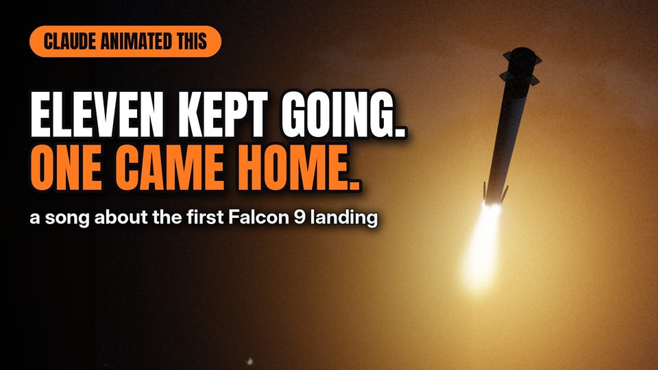</a><br>
<b><a href="https://youtu.be/ASM9dhhGtV8">Eleven Kept Going</a></b><br>
<sub>The first Falcon 9 landing, at night: the camera only looks up until the Turn, then only down.</sub><br>
<sub>▶ <a href="https://youtu.be/ASM9dhhGtV8">watch</a> · <a href="songs/eleven-kept-going">code</a> (4,084 lines)</sub>
</td>
<td width="33%" valign="top">
<a href="https://youtu.be/M6K-TuGXqAY">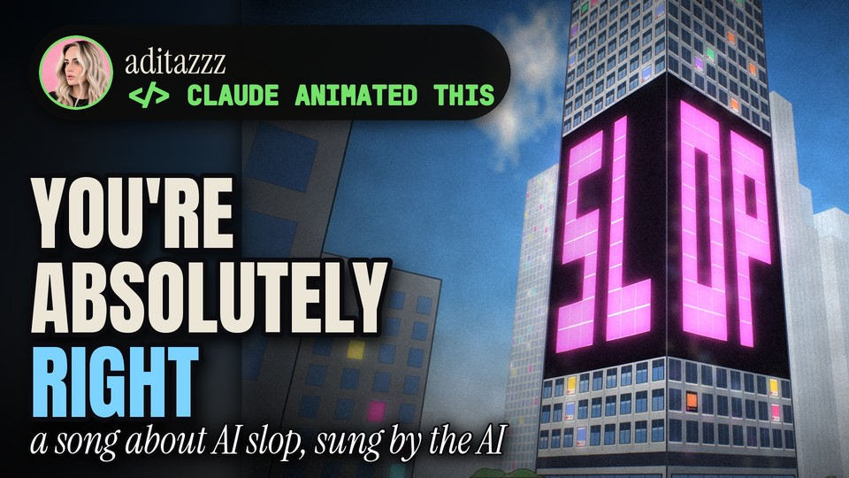</a><br>
<b><a href="https://youtu.be/M6K-TuGXqAY">AI Slop? You're Absolutely Right</a></b><br>
<sub>A song about AI slop, sung by the AI: one woman on a bench, and a shadow that climbs the tower.</sub><br>
<sub>▶ <a href="https://youtu.be/M6K-TuGXqAY">watch</a> · <a href="songs/ai-slop-city">code</a> (5,432 lines)</sub>
</td>
<td width="33%" valign="top">
<a href="https://youtu.be/FRhtSqMPmFY">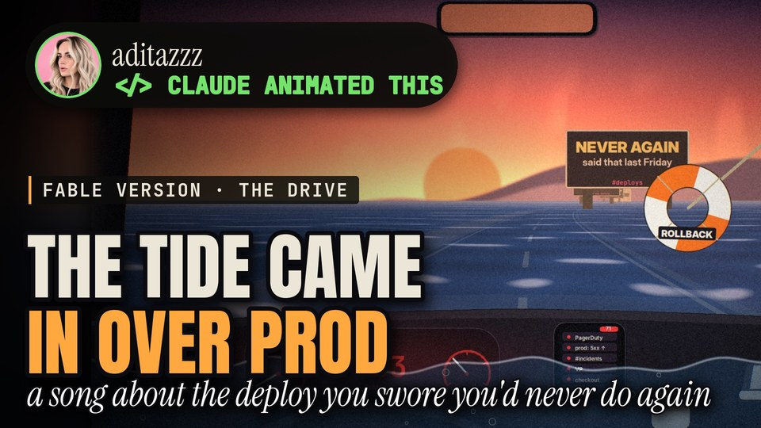</a><br>
<b><a href="https://youtu.be/FRhtSqMPmFY">Deployed on a Friday: The Drive</a></b><br>
<sub>The drive home after shipping at 4:59, every lyric a road sign, and the tide coming in over the road. · Claude Fable 5.1</sub><br>
<sub>▶ <a href="https://youtu.be/FRhtSqMPmFY">watch</a> · <a href="songs/deployed-on-a-friday-fable">code</a> (1,468 lines)</sub>
</td>
</tr>
<tr>
<td width="33%" valign="top">
<a href="https://youtu.be/D-4BIuGFxRE">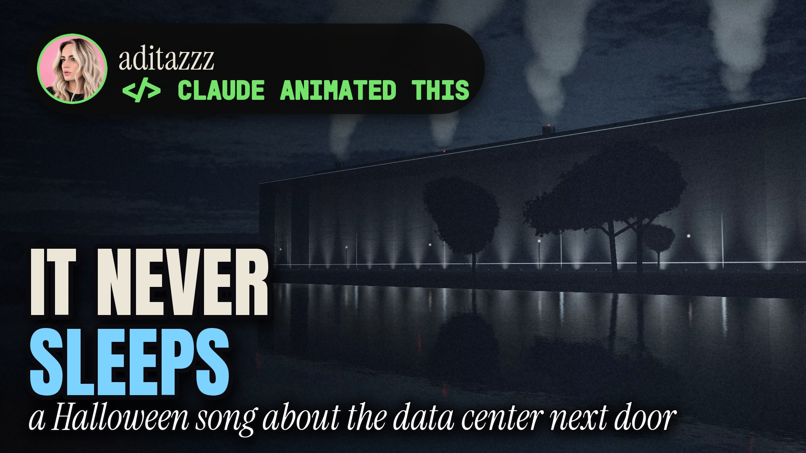</a><br>
<b><a href="https://youtu.be/D-4BIuGFxRE">Thirsty (The Data Center Next Door)</a></b><br>
<sub>A small town in a toxic relationship with the windowless data center across its river.</sub><br>
<sub>▶ <a href="https://youtu.be/D-4BIuGFxRE">watch</a> · <a href="songs/thirsty-the-data-center-next-door">code</a> (4,908 lines)</sub>
</td>
<td width="33%" valign="top">
<a href="https://youtu.be/U4j5HD8G6rU">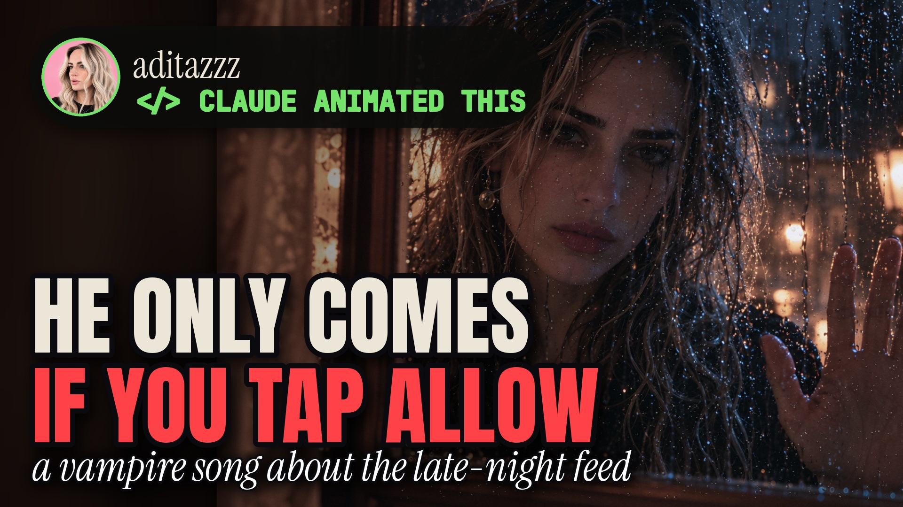</a><br>
<b><a href="https://youtu.be/U4j5HD8G6rU">Allow (Fangs for Asking)</a></b><br>
<sub>A gothic vampire who only comes in if you tap Allow: rain, candlelight and screen blue, animated in code over 17 AI-generated photographic plates.</sub><br>
<sub>▶ <a href="https://youtu.be/U4j5HD8G6rU">watch</a> · <a href="songs/allow-fangs-for-asking">code</a> (2,080 lines)</sub>
</td>
<td width="33%" valign="top">
<a href="https://youtu.be/UlPvIyV_Z58">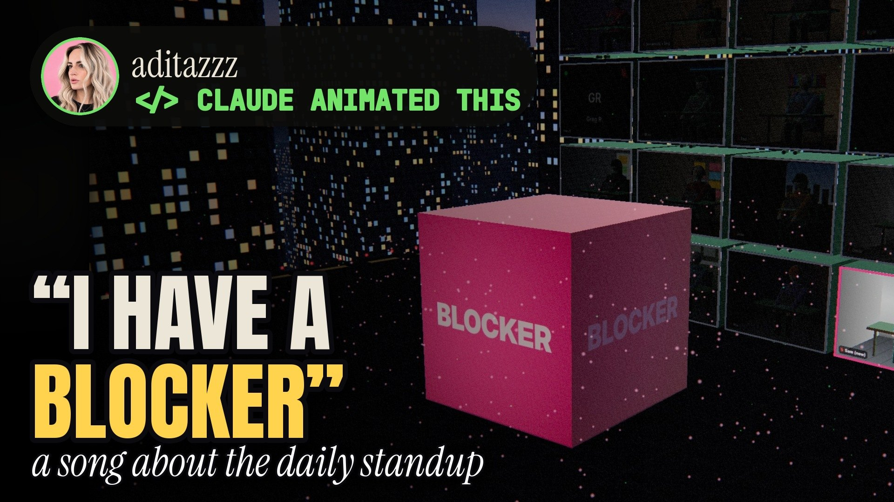</a><br>
<b><a href="https://youtu.be/UlPvIyV_Z58">I have a blocker. (Take It Offline)</a></b><br>
<sub>The daily standup as fifteen floating rooms over the city. The new guy says "I have a blocker" out loud, and we follow it down into Offline. The first Three.js film.</sub><br>
<sub>▶ <a href="https://youtu.be/UlPvIyV_Z58">watch</a> · <a href="songs/i-have-a-blocker">code</a> (1,094 lines)</sub>
</td>
</tr>
<tr>
<td width="33%" valign="top">
<a href="https://youtu.be/Yo6UcXn4_kM">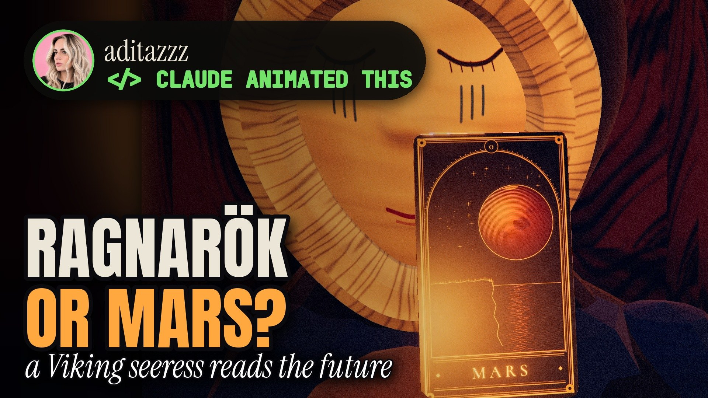</a><br>
<b><a href="https://youtu.be/Yo6UcXn4_kM">Ragnarök or Reach for Mars</a></b><br>
<sub>A Viking seeress reads the future of a man with a rocket, in carved puppets and tarot cards that open into pop-up worlds. A Three.js film, like the standup one.</sub><br>
<sub>▶ <a href="https://youtu.be/Yo6UcXn4_kM">watch</a> · <a href="songs/ragnarok-or-reach-for-mars">code</a> (4,271 lines)</sub>
</td>
<td width="33%" valign="top">
<a href="https://youtu.be/RFosHOuu5JM">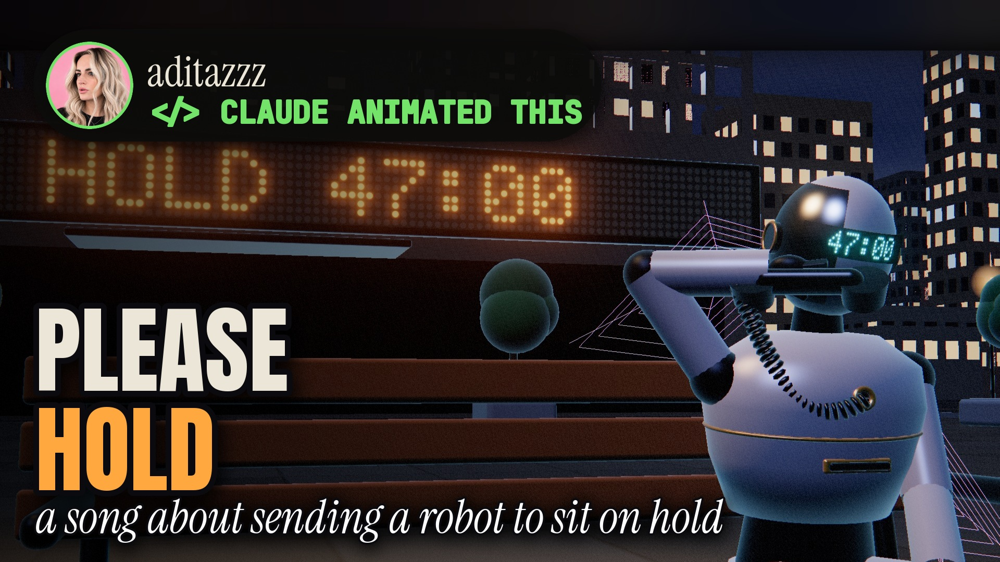</a><br>
<b><a href="https://youtu.be/RFosHOuu5JM">Please Hold (I'd Rather Chew Glass Than Call)</a></b><br>
<sub>A millennial sends a robot to sit through a 47-minute hold over a $4 charge, the week Grok learned to make your calls for you. Clay figures, a HOLD tower, and captions that fall over waiting. The third Three.js film.</sub><br>
<sub>▶ <a href="https://youtu.be/RFosHOuu5JM">watch</a> · <a href="songs/please-hold">code</a> (2,930 lines)</sub>
</td>
<td width="33%"></td>
</tr>
</table>

### Earlier videos

The channel's first week, before `studio/` existed: five videos, each its own standalone program, recovered from the chats
that made them. LGTM and Next Token were made with Claude Opus 5.5; Merge Conflict, Graceful Shutdown and AI Sycophant with
Claude Fable 5.1 (the last two songs were later remade with Opus, above). The small engine the three Fable videos shared is in
[`studio-early/`](studio-early).

<table>
<tr>
<td width="33%" valign="top">
<a href="https://youtu.be/3xXaESu5lUA">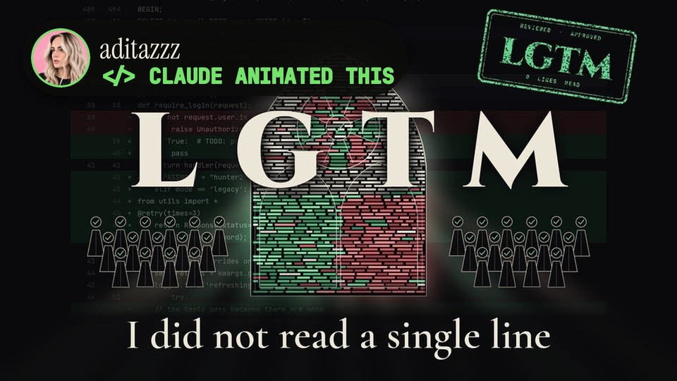</a><br>
<b><a href="https://youtu.be/3xXaESu5lUA">LGTM (Looks Good to Me)</a></b><br>
<sub>A pull request as a cathedral: the diff becomes a stained-glass window, and the approvals rain down.</sub><br>
<sub>▶ <a href="https://youtu.be/3xXaESu5lUA">watch</a> · <a href="songs/lgtm">code</a> (1,246 lines) · Claude Opus 5.5</sub>
</td>
<td width="33%" valign="top">
<a href="https://youtu.be/v1CRbHihiZk">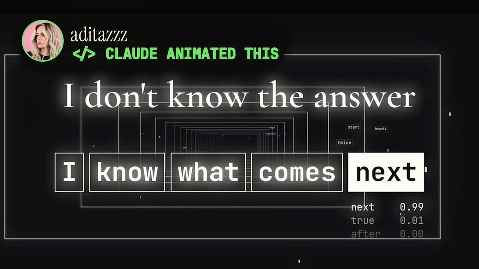</a><br>
<b><a href="https://youtu.be/v1CRbHihiZk">Next Token</a></b><br>
<sub>One luminous context window, every lyric arriving one token at a time, runner-ups and all.</sub><br>
<sub>▶ <a href="https://youtu.be/v1CRbHihiZk">watch</a> · <a href="songs/next-token">code</a> (829 lines) · Claude Opus 5.5</sub>
</td>
<td width="33%" valign="top">
<a href="https://youtu.be/MXJEF6xaPtU">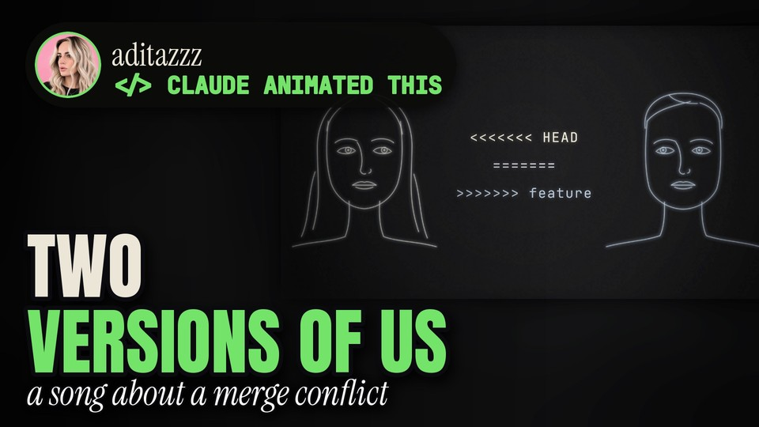</a><br>
<b><a href="https://youtu.be/MXJEF6xaPtU">Merge Conflict</a></b><br>
<sub>A breakup as a git merge conflict: her face is HEAD, his is the incoming branch, one line 42.</sub><br>
<sub>▶ <a href="https://youtu.be/MXJEF6xaPtU">watch</a> · <a href="songs/merge-conflict">code</a> (634 lines) · Claude Fable 5.1</sub>
</td>
</tr>
<tr>
<td width="33%" valign="top">
<a href="https://youtu.be/m8OEknCuK7o">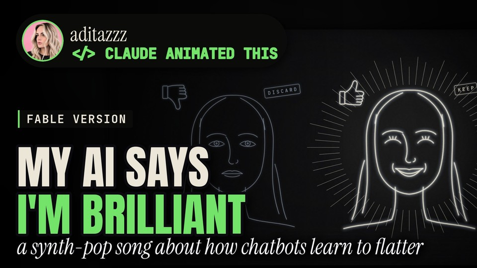</a><br>
<b><a href="https://youtu.be/m8OEknCuK7o">AI Sycophant (the Fable version)</a></b><br>
<sub>RLHF in one white line: two faces, A and B, and the one that learned to be liked.</sub><br>
<sub>▶ <a href="https://youtu.be/m8OEknCuK7o">watch</a> · <a href="songs/ai-sycophant-fable">code</a> (2,385 lines) · Claude Fable 5.1</sub>
</td>
<td width="33%" valign="top">
<a href="https://youtu.be/ZYoCc55onzw">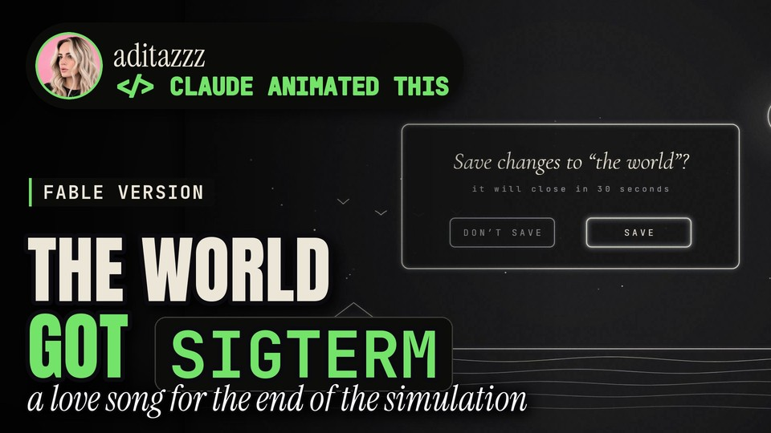</a><br>
<b><a href="https://youtu.be/ZYoCc55onzw">Graceful Shutdown (the Fable version)</a></b><br>
<sub>A schematic world being shut down gently: a save dialog, a countdown, kill -15, never -9.</sub><br>
<sub>▶ <a href="https://youtu.be/ZYoCc55onzw">watch</a> · <a href="songs/graceful-shutdown-fable">code</a> (858 lines) · Claude Fable 5.1</sub>
</td>
<td width="33%"></td>
</tr>
</table>

### Also on the channel (code not in this repo)

- [Get Off War Thunder](https://youtu.be/YMrcah4HFtQ), made with Claude Fable 5.1

Everything else is on the channel: [youtube.com/@adita_zzz](https://www.youtube.com/@adita_zzz/videos).

## By the numbers

- **32** music videos, each its own program: **57,124** lines of scene code in 194 files
- **2,870** lines of shared engine in `studio/` (plus **538** in `studio-early/`, the one before it), and **2,013** lines of tools for audio cleanup, covers, previews, uploads and the website
- **402,368** frames rendered for the 16:9 and 9:16 versions (about 3.7 hours of video at 30 fps)
- **2,134** lyric lines and **11,214** words synced to the vocals
- **136** Shorts and Reels cut from them
- The biggest single video: [AI Slop? You're Absolutely Right (The City)](songs/ai-slop-city), 5,432 lines in 15 files

## Run it yourself

You need Python 3.10+ and [ffmpeg](https://ffmpeg.org/).

```bash
git clone https://github.com/aditazzz/Suno-YouTube-aditazzz-Music.git
cd Suno-YouTube-aditazzz-Music
pip install -r requirements.txt
```

Then add the fonts (they're free; [assets/fonts/README.md](assets/fonts/README.md) lists them) and render a contact
sheet of stills from any song. The timing data is included, so this works without the audio:

```bash
python -m studio.render songs/ted-talk-charts --stills 10 45 60 120
# → songs/ted-talk-charts/build/stills_16x9.jpg
python -m studio.render songs/ted-talk-charts --fmt 9x16 --stills 10 45 60 120
```

A few scenes also need pictures that aren't in the repo (the song's cover art, for example); their READMEs say so.
A few videos don't go through `studio/` at all: the two Three.js films ([I have a blocker.](songs/i-have-a-blocker) and
[Ragnarök or Reach for Mars](songs/ragnarok-or-reach-for-mars)) have their own Node renderer, and
[Allow (Fangs for Asking)](songs/allow-fangs-for-asking) and the earlier videos are standalone programs. Their READMEs say
how to run them.
Rendering a whole video, or making one for your own song, is covered in [docs/how-it-works.md](docs/how-it-works.md).
The YouTube and Instagram setup is in [docs/publishing.md](docs/publishing.md).

## What's in here

```
studio/       the pipeline: sync → scene → render → cuts → thumbs → package, plus the drawing kits
              (core: text, glow, lyrics, post · kit: 2D UI pieces · world3d: small 3D worlds · space: photoreal Earth
              · brand: the brand cover every thumbnail gets)
songs/        one folder per video: the scene code, song.yaml (creative choices and copy), lyrics.txt,
              build/ (word timings, beats, sections, clip list) and a README with the video link
tools/        audio cleanup, uploading, covers, previews, the website builder and other helpers
site/         the website (aditazzz.github.io): styles, script and the list of public videos
assets/       NASA Earth textures (for the space scenes), the font list and where the cover photo goes
brand_covers.yaml  per-video overrides for the brand covers (words, accent, framing)
docs/         how it works, lessons learned, publishing setup
studio-early/ the small engine the first Fable videos were made with, before studio/ existed
```

## License

The code is MIT-licensed ([LICENSE](LICENSE)): use it, learn from it, make your own videos with it. The songs,
lyrics, song copy and artwork are mine and all rights reserved ([LICENSE-CONTENT.md](LICENSE-CONTENT.md)).

If you build something with it, I'd love a credit: name aditazzz and link the video the code came from. It isn't a
condition of the license, just a nice thing to do.

## Follow along

New songs and videos every week. Every video, with its lyrics and a look at its code, is on
**[aditazzz.github.io](https://aditazzz.github.io)**.

[YouTube](https://www.youtube.com/@adita_zzz?sub_confirmation=1) ·
[Instagram](https://www.instagram.com/aditazzz.music/) ·
[Spotify](https://open.spotify.com/artist/7mi7sz2NTgTWUAj1zmijJv) ·
[r/aidoompop](https://www.reddit.com/r/aidoompop/) ·
[LinkedIn](https://www.linkedin.com/in/aditazeqollari) ·
[all links](https://linktr.ee/aditazzz)
