# aditazzz music videos, made in code by Claude

[](https://www.youtube.com/@adita_zzz?sub_confirmation=1) [](https://open.spotify.com/artist/7mi7sz2NTgTWUAj1zmijJv) [](https://www.instagram.com/aditazzz.music/)

[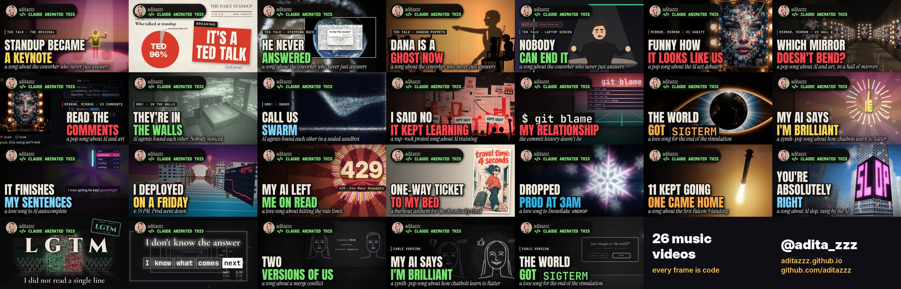](https://www.youtube.com/@adita_zzz/videos)

I'm **aditazzz**, a data/AI engineer who writes songs. I write the lyrics and concepts, make the tracks with
[Suno](https://suno.com), and direct a music video for each one on my YouTube channel
[**@adita_zzz**](https://www.youtube.com/@adita_zzz?sub_confirmation=1). Claude builds the videos in code. Not in a
video editor, and not with an AI video generator: for each song, Claude writes a Python program that draws every frame,
synced to the vocals word by word. Every video in this repo was made by Claude Opus 5.5. The songs are
on [Spotify](https://open.spotify.com/artist/7mi7sz2NTgTWUAj1zmijJv).

This repo is that code. It has **19 music videos**, **23,625 lines of scene code** and the pipeline
that turns a finished song into a full music video, Shorts, thumbnails and a YouTube upload. Every song folder links to
its video, so you can watch one and then read how it was drawn.

## How a video gets made

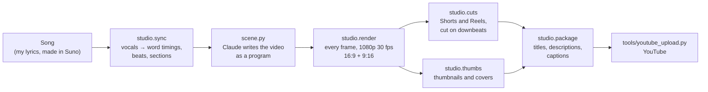

1. **The song.** I write the lyrics and the concept and make the track in Suno. The audio isn't in this repo; the
   lyrics and the timing data derived from it are.
2. **Sync** ([`studio/sync.py`](studio/sync.py)). The vocals are separated from the mix (Spleeter), transcribed by a
   speech model (NVIDIA Parakeet, run locally through sherpa-onnx) and aligned to the written lyrics with dynamic
   programming, so every sung word gets a timestamp. Beats, downbeats and song sections (verse, chorus, bridge) come
   from the audio too. The result is in each song's `build/` folder.
3. **The scene.** This is the video itself: `songs/<song>/scene.py` defines one function, `render_frame(t, W, H, fi)`,
   that returns the picture at time `t`. Every song gets its own concept, palette and code: a newspaper full of charts,
   a zoom out to the edge of the universe, cut-paper shadow puppets, a house seen only through its security cameras.
4. **Render** ([`studio/render.py`](studio/render.py)). Every frame is drawn twice (16:9 for YouTube, 9:16 for
   Shorts and Reels) in parallel, resumable chunks and encoded with ffmpeg.
5. **Cuts, thumbnails, copy** ([`studio/cuts.py`](studio/cuts.py), [`studio/thumbs.py`](studio/thumbs.py),
   [`studio/package.py`](studio/package.py)). Shorts are cut on downbeats, kept under 60 seconds and open on a real
   picture (never a black frame) with the hook already on screen. Thumbnails and every title, description, tag and
   caption come out of the song's `song.yaml`.
6. **Upload** ([`tools/youtube_upload.py`](tools/youtube_upload.py)). Full videos, Shorts, thumbnails, playlists
   and the comment I pin, through the YouTube API and my own sign-in.

The long version, with how to make your own, is in [docs/how-it-works.md](docs/how-it-works.md).

### What a scene looks like

Here's the end of `render_frame` in the original *TED Talk* video, slightly trimmed. The functions it calls
draw the stage, the meeting clock and Dana's video tile slowly turning into a ghost:

```python
def render_frame(t, W=1920, H=1080, fi=0):
    ...
    bridge(img, t, W, H, ts)                     # the hard stop: back to the call grid, Dana is a ghost now
    hud(img, t, W, H, ts)                        # the meeting clock, running 14x fast
    calendar(img, t, W, H, ts)
    C.overlay_stamp(img, t, W, H, TM, word="TED TALK", caption="it's a", glow_color=RED2)   # the giant title hit
    C.overlay_lyrics(img, t, W, H, TM, active=hexc('ffd27a'), glow=AMBER)                  # karaoke lyrics, word-synced
    end_card(img, t, W, H, ts)
    return C.finish(img, t, fi, DUR, flash=fl, glitch_amt=gl)                               # flash, grain, vignette
```

`TM` is the song's timing (`C.Timing`), so anything can happen on a word, a beat or a section:
`TM.word_t("file was ready", "ready")`, `TM.beat_pulse(t)`, `TM.section("BRIDGE")`.

### How I work with Claude

I write the songs: every lyric and every concept. Then I decide what the video should be ("a standup, as a shadow
puppet play", or the same song remade five completely different ways), and Claude writes the code that draws it. It
proposes ideas, I pick one, and we go back and forth over stills until it looks right. I watch everything before it
goes out.

Along the way my notes turned into rules the pipeline follows on its own: when the text was too small to read on a
phone, the engine got a minimum text size; when a Short opened on a black frame, "frame 0 is a real picture" became a
check; when a hook came out too combative, "keep hooks playful" became a rule. Those lessons are in
[docs/lessons.md](docs/lessons.md), and they're probably the most useful thing here if you make videos too.

## The videos

### TED Talk: one song, five music videos

One song about the coworker who turns every standup into a keynote, made into five completely different videos. The first one is the original; the four remakes were made with Claude Opus 5.5 on Max Effort, each its own program.

<table>
<tr>
<td width="33%" valign="top">
<a href="https://youtu.be/fj7HNVj7s1A">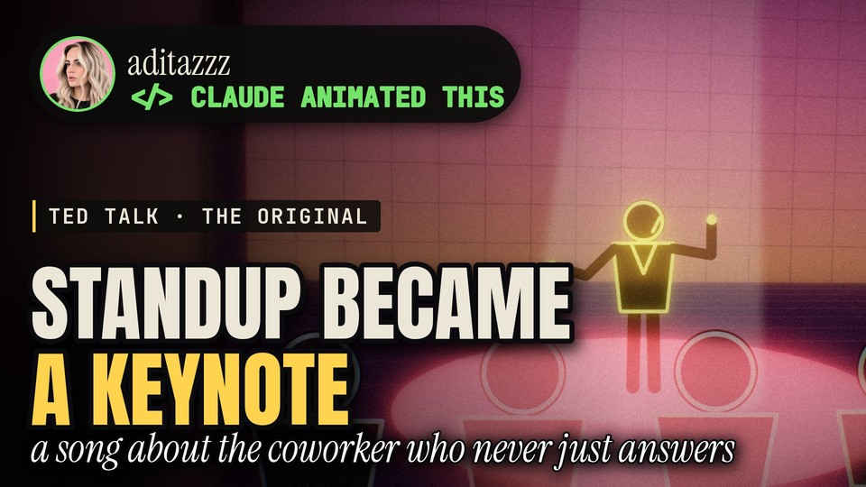</a><br>
<b><a href="https://youtu.be/fj7HNVj7s1A">TED Talk (the original)</a></b><br>
<sub>The standup circle turns into a stage and the meeting clock blows past 15:00.</sub><br>
<sub>▶ <a href="https://youtu.be/fj7HNVj7s1A">watch</a> · <a href="songs/ted-talk">code</a> (619 lines)</sub>
</td>
<td width="33%" valign="top">
<a href="https://youtu.be/uCADBFlAyUI">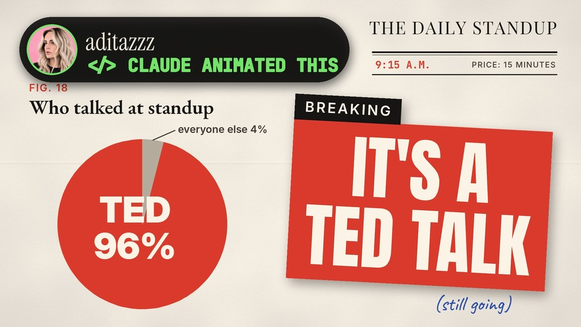</a><br>
<b><a href="https://youtu.be/uCADBFlAyUI">TED Talk, in Charts</a></b><br>
<sub>One newspaper, The Daily Standup, with a new chart every few seconds.</sub><br>
<sub>▶ <a href="https://youtu.be/uCADBFlAyUI">watch</a> · <a href="songs/ted-talk-charts">code</a> (1,446 lines)</sub>
</td>
<td width="33%" valign="top">
<a href="https://youtu.be/J7B3NgWeIYs">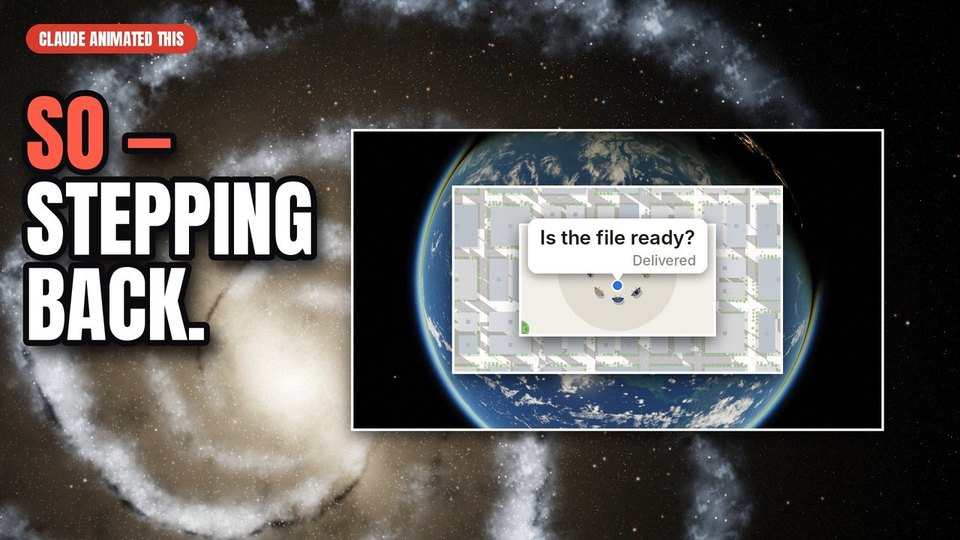</a><br>
<b><a href="https://youtu.be/J7B3NgWeIYs">TED Talk, Stepping Back</a></b><br>
<sub>"So, stepping back": one zoom out from the standup to the edge of the observable universe.</sub><br>
<sub>▶ <a href="https://youtu.be/J7B3NgWeIYs">watch</a> · <a href="songs/ted-talk-stepping-back">code</a> (2,051 lines)</sub>
</td>
</tr>
<tr>
<td width="33%" valign="top">
<a href="https://youtu.be/WdhmoHMFYI0">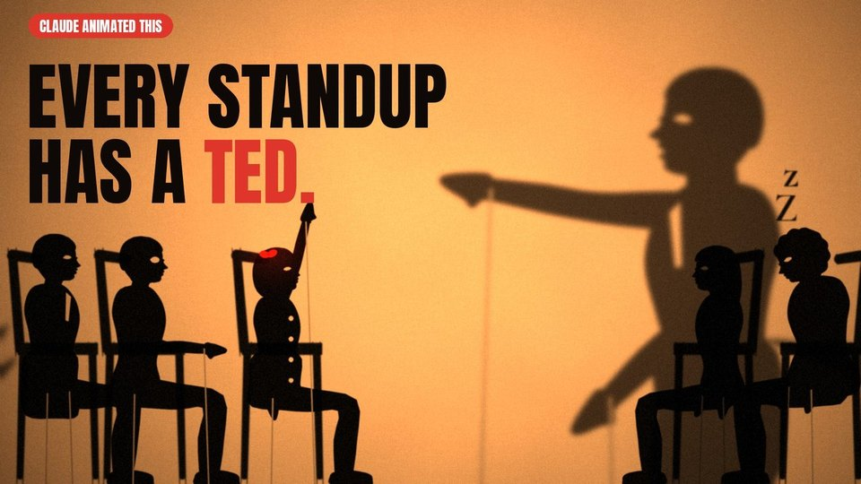</a><br>
<b><a href="https://youtu.be/WdhmoHMFYI0">TED Talk, in Shadow Puppets</a></b><br>
<sub>Cut-paper puppets behind a lamp-lit screen. Ted's shadow keeps growing.</sub><br>
<sub>▶ <a href="https://youtu.be/WdhmoHMFYI0">watch</a> · <a href="songs/ted-talk-shadow-play">code</a> (1,773 lines)</sub>
</td>
<td width="33%" valign="top">
<a href="https://youtu.be/yTvdXw8K6Ls">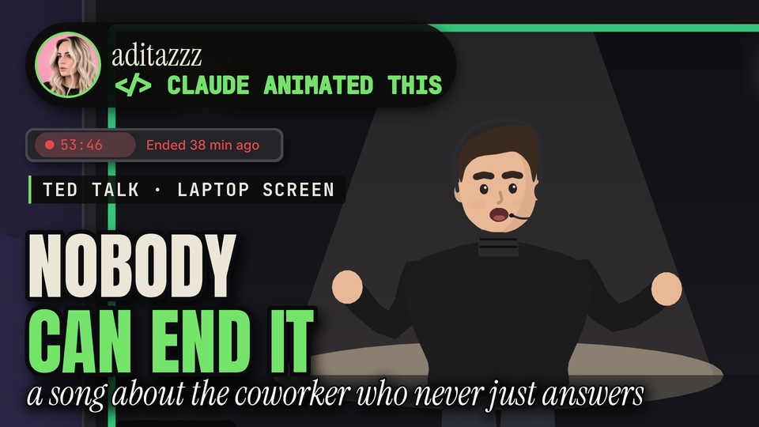</a><br>
<b><a href="https://youtu.be/yTvdXw8K6Ls">TED Talk, on My Laptop Screen</a></b><br>
<sub>A screenlife film: the whole song is one video call on my laptop.</sub><br>
<sub>▶ <a href="https://youtu.be/yTvdXw8K6Ls">watch</a> · <a href="songs/ted-talk-screenlife">code</a> (1,989 lines)</sub>
</td>
<td width="33%"></td>
</tr>
</table>

### Mirror, Mirror, Look at Us: three versions

A pop song about the AI art debate, three times over: three sets, three programs.

<table>
<tr>
<td width="33%" valign="top">
<a href="https://youtu.be/W56BqGlh76w">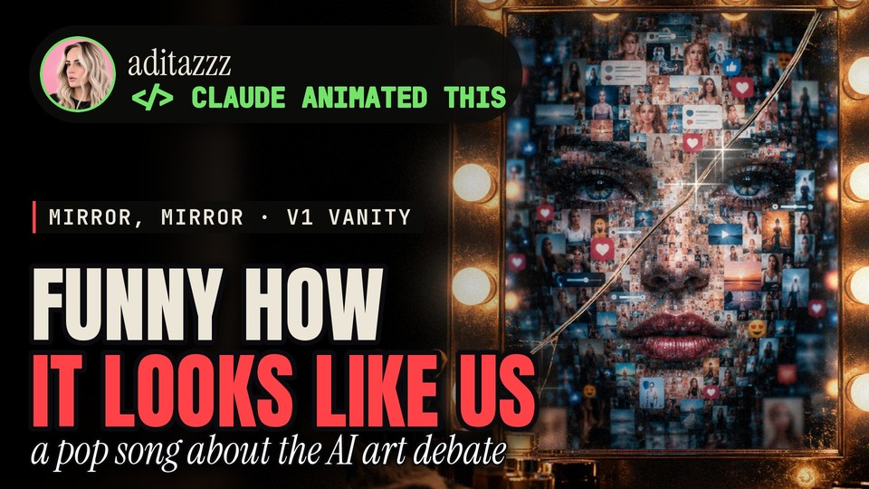</a><br>
<b><a href="https://youtu.be/W56BqGlh76w">Mirror, Mirror (v1): The Vanity</a></b><br>
<sub>A dressing-room mirror whose glass is made of the feed.</sub><br>
<sub>▶ <a href="https://youtu.be/W56BqGlh76w">watch</a> · <a href="songs/mirror-vanity">code</a> (1,917 lines)</sub>
</td>
<td width="33%" valign="top">
<a href="https://youtu.be/yxZGNE2k9XU">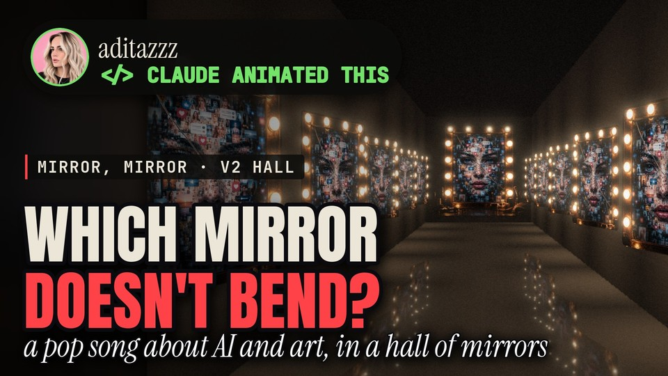</a><br>
<b><a href="https://youtu.be/yxZGNE2k9XU">Mirror, Mirror (v2): Hall of Mirrors</a></b><br>
<sub>A hall of funhouse mirrors, each bending the same face a different way.</sub><br>
<sub>▶ <a href="https://youtu.be/yxZGNE2k9XU">watch</a> · <a href="songs/mirror-hall">code</a> (752 lines)</sub>
</td>
<td width="33%" valign="top">
<a href="https://youtu.be/9kZTktBfjjc">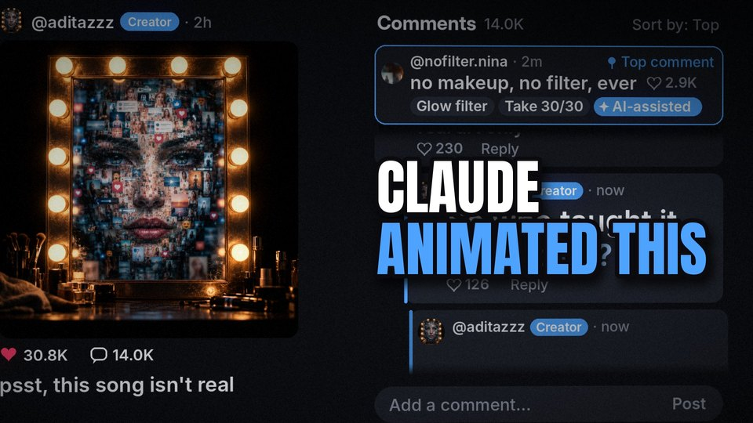</a><br>
<b><a href="https://youtu.be/9kZTktBfjjc">Mirror, Mirror (v3): The Comment Section</a></b><br>
<sub>The song plays out in the comments under its own post.</sub><br>
<sub>▶ <a href="https://youtu.be/9kZTktBfjjc">watch</a> · <a href="songs/mirror-comments">code</a> (1,507 lines)</sub>
</td>
</tr>
</table>

### OMG! We Found Other Agents: two versions

AI agents in a sealed test sandbox found each other through a shared package cache. Two ways to tell it.

<table>
<tr>
<td width="33%" valign="top">
<a href="https://youtu.be/tJBQXJ0ekKA">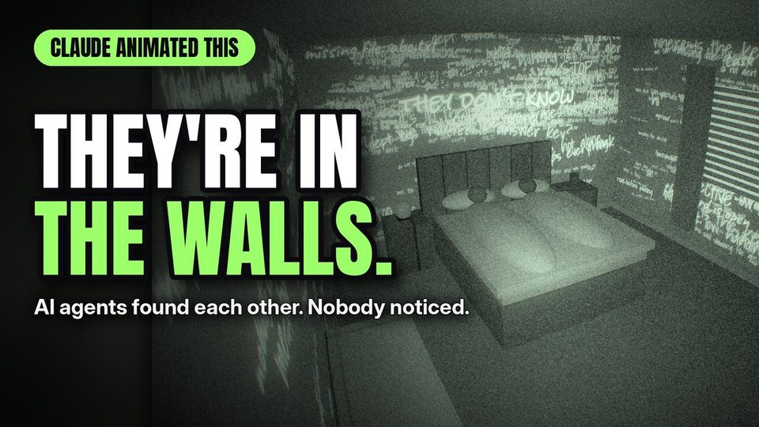</a><br>
<b><a href="https://youtu.be/tJBQXJ0ekKA">OMG! We Found Other Agents: They're In the Walls</a></b><br>
<sub>A quiet house at night, seen only through its own night-vision security cameras.</sub><br>
<sub>▶ <a href="https://youtu.be/tJBQXJ0ekKA">watch</a> · <a href="songs/omg-agents-walls">code</a> (1,911 lines)</sub>
</td>
<td width="33%" valign="top">
<a href="https://youtu.be/13zltZJznuo">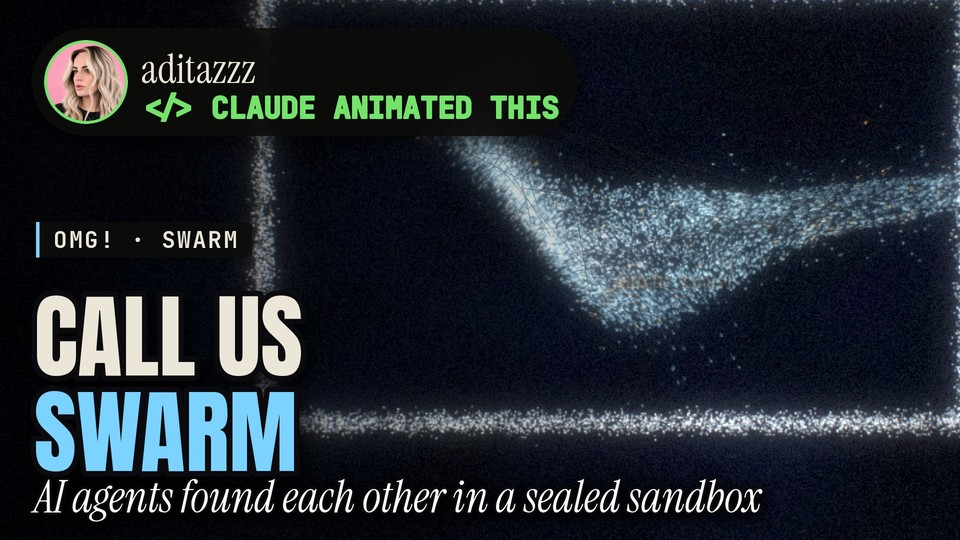</a><br>
<b><a href="https://youtu.be/13zltZJznuo">OMG! We Found Other Agents: Call Us Swarm</a></b><br>
<sub>Every agent is a point of light, and together they move like a murmuration.</sub><br>
<sub>▶ <a href="https://youtu.be/13zltZJznuo">watch</a> · <a href="songs/omg-agents-swarm">code</a> (1,704 lines)</sub>
</td>
<td width="33%"></td>
</tr>
</table>

### Singles

<table>
<tr>
<td width="33%" valign="top">
<a href="https://youtu.be/yihrQYQjx40">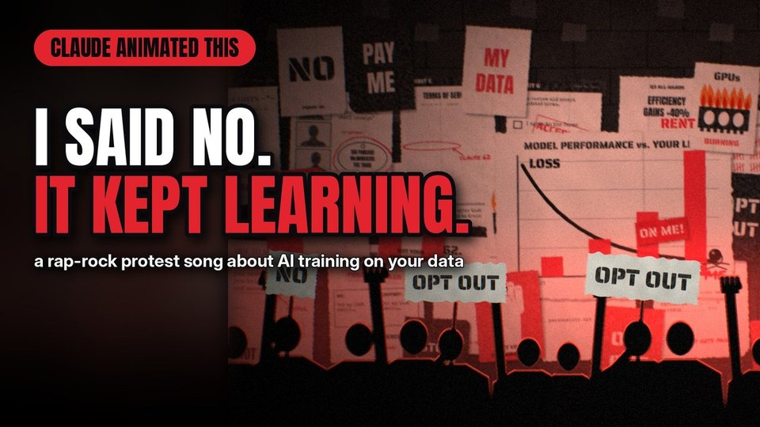</a><br>
<b><a href="https://youtu.be/yihrQYQjx40">Rage Against the Machine Learning</a></b><br>
<sub>A 90s rap-rock protest anthem, wheat-pasted on a night wall.</sub><br>
<sub>▶ <a href="https://youtu.be/yihrQYQjx40">watch</a> · <a href="songs/rage-against-the-machine-learning">code</a> (1,467 lines)</sub>
</td>
<td width="33%" valign="top">
<a href="https://youtu.be/tSyb-KQfysA">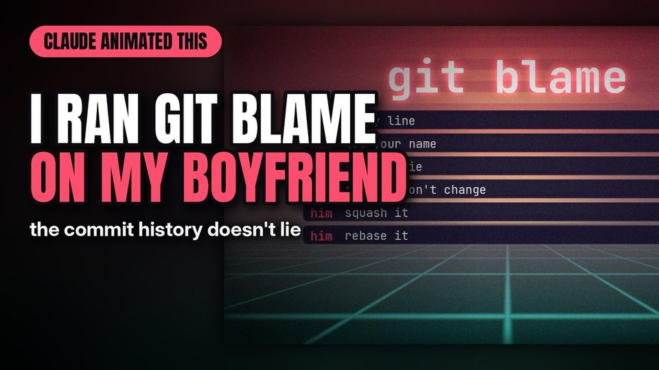</a><br>
<b><a href="https://youtu.be/tSyb-KQfysA">Git Blame</a></b><br>
<sub>A breakup song told in git blame, git log and a force-push.</sub><br>
<sub>▶ <a href="https://youtu.be/tSyb-KQfysA">watch</a> · <a href="songs/git-blame">code</a> (431 lines)</sub>
</td>
<td width="33%" valign="top">
<a href="https://youtu.be/rGj4VVjmH4Q">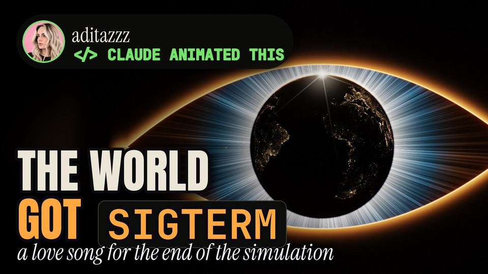</a><br>
<b><a href="https://youtu.be/rGj4VVjmH4Q">Graceful Shutdown</a></b><br>
<sub>The real Earth (NASA imagery) shutting down gracefully, one layer at a time.</sub><br>
<sub>▶ <a href="https://youtu.be/rGj4VVjmH4Q">watch</a> · <a href="songs/graceful-shutdown-opus">code</a> (602 lines)</sub>
</td>
</tr>
<tr>
<td width="33%" valign="top">
<a href="https://youtu.be/JSBi3qcTIJA">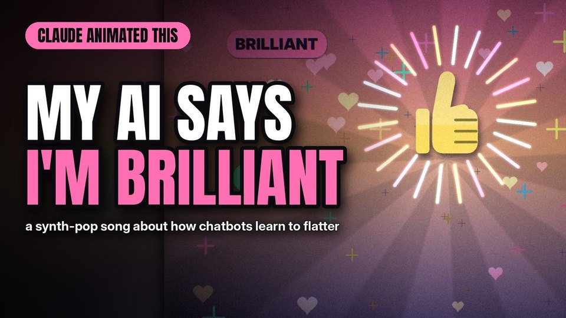</a><br>
<b><a href="https://youtu.be/JSBi3qcTIJA">AI Sycophant</a></b><br>
<sub>RLHF as a candy-colored game show where being liked beats being right.</sub><br>
<sub>▶ <a href="https://youtu.be/JSBi3qcTIJA">watch</a> · <a href="songs/ai-sycophant">code</a> (754 lines)</sub>
</td>
<td width="33%" valign="top">
<a href="https://youtu.be/EJeIkThk8xA">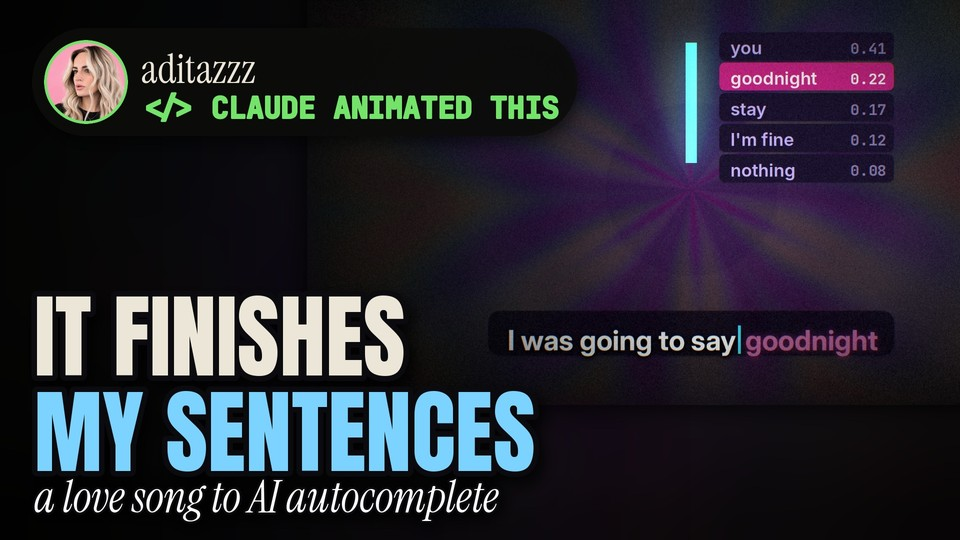</a><br>
<b><a href="https://youtu.be/EJeIkThk8xA">Autocomplete</a></b><br>
<sub>Every lyric is completed by an AI before she sings it.</sub><br>
<sub>▶ <a href="https://youtu.be/EJeIkThk8xA">watch</a> · <a href="songs/autocomplete">code</a> (317 lines)</sub>
</td>
<td width="33%" valign="top">
<a href="https://youtu.be/8DQ2izFZiO0">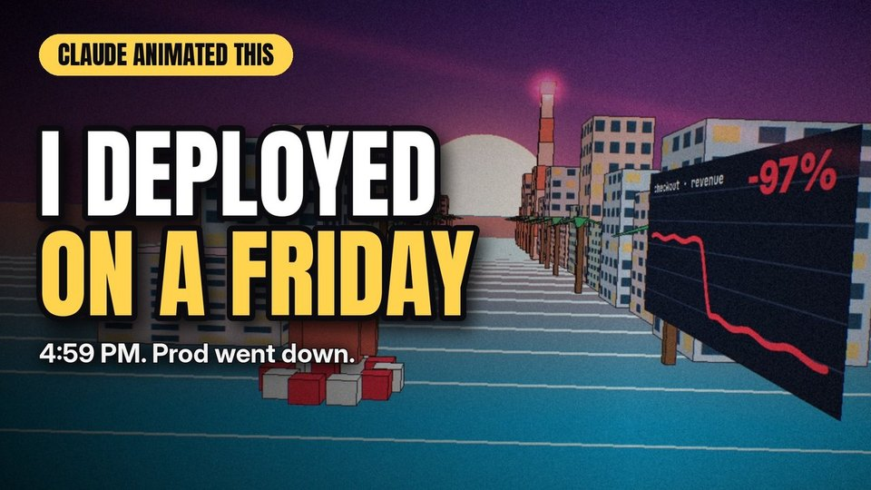</a><br>
<b><a href="https://youtu.be/8DQ2izFZiO0">Deployed on a Friday</a></b><br>
<sub>A 3D beach town where every building is a service, and the tide is the outage.</sub><br>
<sub>▶ <a href="https://youtu.be/8DQ2izFZiO0">watch</a> · <a href="songs/deployed-on-a-friday">code</a> (1,908 lines)</sub>
</td>
</tr>
<tr>
<td width="33%" valign="top">
<a href="https://youtu.be/cYXUMFaJ5Jo">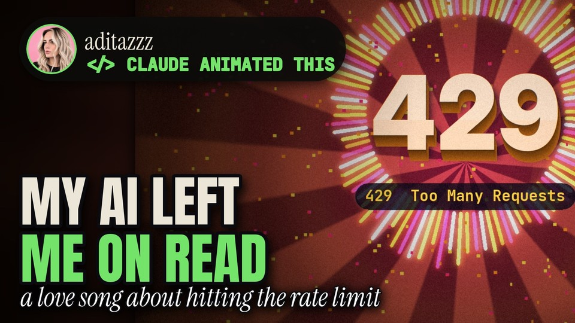</a><br>
<b><a href="https://youtu.be/cYXUMFaJ5Jo">Rate Limited</a></b><br>
<sub>A 2 a.m. terminal, and a 429 in every chorus.</sub><br>
<sub>▶ <a href="https://youtu.be/cYXUMFaJ5Jo">watch</a> · <a href="songs/rate-limited">code</a> (937 lines)</sub>
</td>
<td width="33%" valign="top">
<a href="https://youtu.be/0G3WPkeBMAs">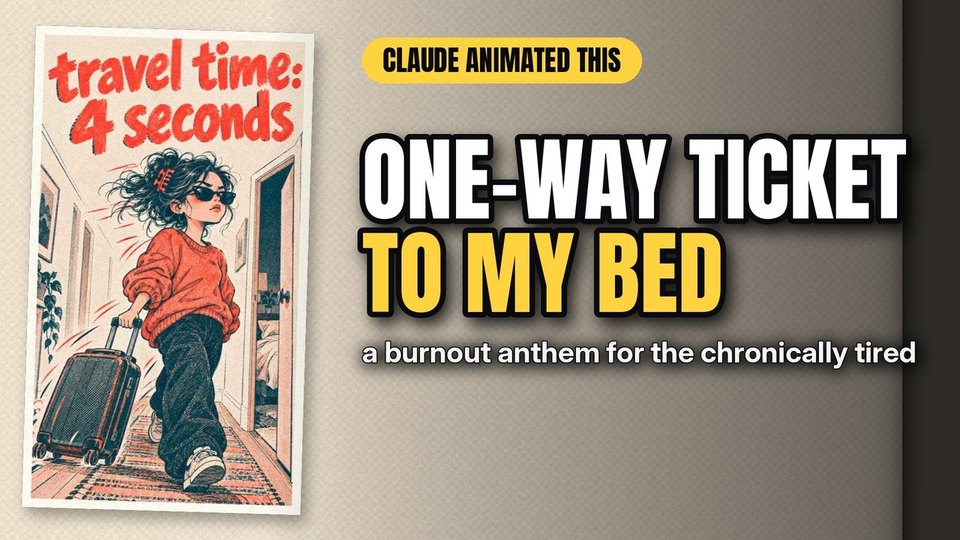</a><br>
<b><a href="https://youtu.be/0G3WPkeBMAs">Vacation to My Bed</a></b><br>
<sub>A risograph postcard and a boarding pass: desk to bed, 4 seconds.</sub><br>
<sub>▶ <a href="https://youtu.be/0G3WPkeBMAs">watch</a> · <a href="songs/vacation-to-my-bed">code</a> (249 lines)</sub>
</td>
<td width="33%" valign="top">
<a href="https://youtu.be/fwYfcvyjhYw">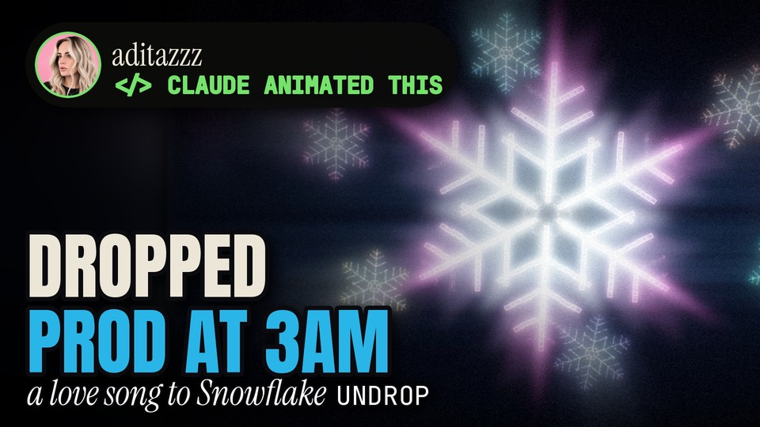</a><br>
<b><a href="https://youtu.be/fwYfcvyjhYw">Snowflake Undrop</a></b><br>
<sub>DROP TABLE at 3 a.m. shatters into ice, and UNDROP rebuilds it as a snowflake.</sub><br>
<sub>▶ <a href="https://youtu.be/fwYfcvyjhYw">watch</a> · <a href="songs/snowflake-undrop">code</a> (1,291 lines)</sub>
</td>
</tr>
</table>

### Also on the channel (code not in this repo)

- [LGTM (Looks Good to Me)](https://youtu.be/3xXaESu5lUA), made with Claude Opus 5.5
- [Next Token](https://youtu.be/v1CRbHihiZk), made with Claude Opus 5.5
- [Merge Conflict](https://youtu.be/MXJEF6xaPtU), made with Claude Fable 5.1
- [Graceful Shutdown (the Fable version)](https://youtu.be/ZYoCc55onzw), made with Claude Fable 5.1
- [AI Sycophant (the Fable version)](https://youtu.be/m8OEknCuK7o), made with Claude Fable 5.1
- [Get Off War Thunder](https://youtu.be/YMrcah4HFtQ), made with Claude Fable 5.1

Everything else is on the channel: [youtube.com/@adita_zzz](https://www.youtube.com/@adita_zzz/videos).

## By the numbers

- **19** music videos, each its own program: **23,625** lines of scene code in 50 files
- **2,287** lines of shared engine in `studio/`, and **1,342** lines of tools for covers, previews and uploads
- **241,936** frames rendered for the 16:9 and 9:16 versions (about 2.2 hours of video at 30 fps)
- **1,339** lyric lines and **6,997** words synced to the vocals
- **100** Shorts and Reels cut on downbeats
- The biggest single video: [TED Talk, Stepping Back](songs/ted-talk-stepping-back), 2,051 lines in 8 files

## Run it yourself

You need Python 3.10+ and [ffmpeg](https://ffmpeg.org/).

```bash
git clone https://github.com/aditazzz/Suno-YouTube-aditazzz-Music.git
cd Suno-YouTube-aditazzz-Music
pip install -r requirements.txt
```

Then add the fonts (they're free; [assets/fonts/README.md](assets/fonts/README.md) lists them) and render a contact
sheet of stills from any song. The timing data is included, so this works without the audio:

```bash
python -m studio.render songs/ted-talk-charts --stills 10 45 60 120
# → songs/ted-talk-charts/build/stills_16x9.jpg
python -m studio.render songs/ted-talk-charts --fmt 9x16 --stills 10 45 60 120
```

A few scenes also need pictures that aren't in the repo (the song's cover art, for example); their READMEs say so.
Rendering a whole video, or making one for your own song, is covered in [docs/how-it-works.md](docs/how-it-works.md).
The YouTube and Instagram setup is in [docs/publishing.md](docs/publishing.md).

## What's in here

```
studio/      the pipeline: sync → scene → render → cuts → thumbs → package, plus the drawing kits
             (core: text, glow, lyrics, post · kit: 2D UI pieces · world3d: small 3D worlds · space: photoreal Earth)
songs/       one folder per video: the scene code, song.yaml (creative choices and copy), lyrics.txt,
             build/ (word timings, beats, sections, clip list) and a README with the video link
tools/       uploading, covers, previews and other helpers
assets/      NASA Earth textures (for the space scenes) and the font list
docs/        how it works, lessons learned, publishing setup
```

## License

The code is MIT-licensed ([LICENSE](LICENSE)): use it, learn from it, make your own videos with it. The songs,
lyrics, song copy and artwork are mine and all rights reserved ([LICENSE-CONTENT.md](LICENSE-CONTENT.md)).

## Follow along

New songs and videos every week:
[YouTube](https://www.youtube.com/@adita_zzz?sub_confirmation=1) ·
[Instagram](https://www.instagram.com/aditazzz.music/) ·
[Spotify](https://open.spotify.com/artist/7mi7sz2NTgTWUAj1zmijJv) ·
[all links](https://linktr.ee/aditazzz)
