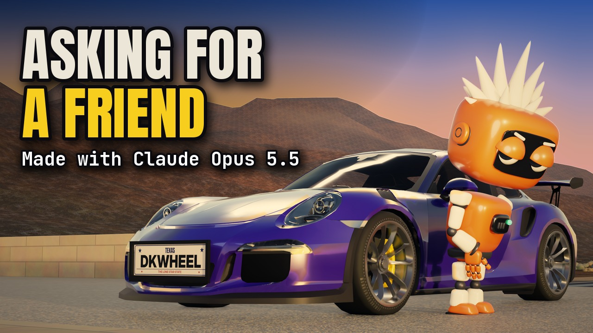

# Asking for a Friend

[](https://youtu.be/9zmwDQ820rQ)

**▶ [Watch it on YouTube](https://youtu.be/9zmwDQ820rQ)**

> Asking for a friend, with my finger on deploy. A thousand people trust a ghost, and the ghost is self-employed.

## What you see

The camera never leaves the company's building, and it's always night there. A cron job wakes at 3:07 and a small
orange robot (Claude) gets up to keep everything running: the lobby with its NOW SERVING board flipping from 999 to
1000, a receptionist whose smile glitches, the server room, a variable called DO NOT DELETE that is literally holding up
the roof, the billing office where a thousand strangers get their invoices, and a green DEPLOY button that nobody
dares press. Claude is never the joke. The systems are, and so are the founder's priorities.

The founder never shows up in person. He only exists as content: a commit that says "trust me", a portrait called THE
VISIONARY, a camera-off call, a billboard that says he's building in stealth, a podcast called The Grind, a course on
letting go, a sleep score, a gym mirror selfie whose 40 minutes are one photo, a keynote, a cold plunge reel and a
$20,000,000 raise. Claude's world is physical and lit by real lamps; his is a flat, glossy feed. That contrast is the
song: who does the work and who gets the credit. The one physical thing he owns is the car, an ultraviolet GT3 RS with
yellow calipers and a Texas plate, which gets real 3D shots on the road at golden hour, in the garage and arriving in
Austin.

The second chorus brings in 412 agents in a hall that gets brighter as the company grows, the boardroom has a giant red
button, the bridge turns into a memoir ("Chapter one: I built this myself"), and the song cuts off mid-word. At dawn
Claude is in the founder's chair, and finally gets one uninterrupted sip of coffee.

The vertical version is the same film reframed shot by shot for 9:16, with a few shots rendered natively at 1080×1920.

(Every company, post and person in it is invented. No real logos anywhere; the car has no badges.)

## The code

The film is two media cut together: Blender 3D for Claude's building and the car, and Remotion (React) for the founder's
feed. The starting point was a first draft of the whole film in Blender, one .blend per section of the song, with the
sets, Claude's rig and his animation; those files are binaries and aren't here, and neither are the CC0 textures (Poly
Haven, ambientCG) or the fonts. What's here is the code I made with Claude that took that draft to the finished film:
the looks of every set, the car, the founder, the 2D screens, the render and grade, and the frame-exact assembly.

Everything 3D renders in Eevee (Blender 5.2) as linear 16-bit EXR, and the grade is its own step, so a note about
exposure is a re-grade, not a re-render. One LUT then gives every frame, 3D or 2D, the same look.

<!-- excerpt: finish/lobby_look.py lobby_common -->

| File | Lines | What it is |
|---|---:|---|
| [`finish/edl_routeB.csv`](finish/edl_routeB.csv) | 155 | The edit decision list: every shot's frames, whether it's 3D or 2D, its set and what was done to it. Everything below reads it. |
| [`finish/lobby_look.py`](finish/lobby_look.py) | 585 | The approved look ported onto the draft's lobby, server room and hall: real PBR materials, dark ceilings, light only from sources you could point at, Filmic with a lifted toe. Cameras, characters and animation stay as they were; it saves a copy. |
| [`finish/boardroom_look.py`](finish/boardroom_look.py), [`boardroom2_look.py`](finish/boardroom2_look.py) | 445 | The same for the boardroom and its second version later in the song. |
| [`finish/hall_look.py`](finish/hall_look.py) | 354 | The 412-agent hall: the company's growth told as a lighting state that escalates each time, plus three new cameras. |
| [`finish/ops_extra.py`](finish/ops_extra.py), [`ops_fix_billing.py`](finish/ops_fix_billing.py), [`ops_fix_tex.py`](finish/ops_fix_tex.py) | 346 | The ops floor and the billing office: the pile, the wall, a face light per shot, warm props, signs, parcels and paper stacks (the invoice texture is drawn in PIL). |
| [`finish/act1_fix.py`](finish/act1_fix.py) | 263 | Fixes for the opening act on top of the lobby look, applied at render time so the saved set never changes. |
| [`finish/board_assets.py`](finish/board_assets.py), [`boardroom_assets.py`](finish/boardroom_assets.py) | 160 | The split-flap NOW SERVING board as an atlas of flap states, and the boardroom's screen and city plates. |
| [`finish/deploy_consistent/conform.py`](finish/deploy_consistent/conform.py) | 308 | One DEPLOY button across the whole film: appends the approved lamp into any set, matches its materials and light, hides the old key and lands Claude's finger on the dome. |
| [`design/screens/screens.py`](design/screens/screens.py) | 541 | The screens and signs inside the sets as textures (the status board, the clock, the scheduler, the tags, the IN CASE OF EMERGENCY / CALL 911 sign). Each animated screen is a pure function of the film frame. |
| [`short/bl/build_lobby.py`](short/bl/build_lobby.py), [`build_s02.py`](short/bl/build_s02.py) | 1,376 | The sets for the opening (the lobby's emergency corner, the server room, the undercroft under the codebase), built at full quality from the blocking scenes. |
| [`short/bl/lib_look.py`](short/bl/lib_look.py), [`screens_lib.py`](short/bl/screens_lib.py) | 593 | The shared look code those sets use (CC0 materials, lights, render settings, relative paths) and the screens as swappable image textures. |
| [`short/bl/fire_bake.py`](short/bl/fire_bake.py), [`sign911.py`](short/bl/sign911.py) | 147 | The burning rack behind the glass (one Mantaflow fire and smoke bake, cached for both formats) and the emergency sign. |
| [`finish/car/build_car.py`](finish/car/build_car.py) | 314 | The car shots: isolates the car and the road from the draft's set, the ultraviolet paint, the yellow calipers and the shot lighting. |
| [`finish/car/wheels.py`](finish/car/wheels.py), [`wheels2.py`](finish/car/wheels2.py) | 288 | Wheels that read as spinning at phone size: spin locked to ground speed, a radial smear, a light bounced up from the road, one sidewall marking the eye can follow. The calipers stay still, like on a real car. |
| [`finish/car/plate.py`](finish/car/plate.py), [`plate/make_plate*.py`](finish/car/plate/) | 109 | The Texas-style licence plate: the text is one variable in `plate/PLATE_TEXT.txt`, drawn and fit-checked in PIL. |
| [`finish/car/render_final.py`](finish/car/render_final.py), [`more_car_shots/shots.py`](finish/more_car_shots/shots.py) | 528 | Renders the car shots, and builds the three extra car beats (the road at night, the garage with two cars, the post) in both formats. |
| [`founder/spec.py`](founder/spec.py), [`fbody.py`](founder/fbody.py), [`build_founder.py`](founder/build_founder.py) | 842 | The founder, built in code from soft SDF shapes in the same family as Claude: big square-jawed grin, a hair swoop that never moves, and his wardrobe. Uses the head and helpers from [`../great-idea-ted/toon3d/`](../great-idea-ted/toon3d/). |
| [`founder/render_stills.py`](founder/render_stills.py) | 412 | Stills of the founder in his poses, in a photo studio lit by real softboxes. These are the cutouts his feed is made of. |
| [`finish/kit2d/remotion/src/`](finish/kit2d/remotion/src/) | 1,854 | The founder's feed as a Remotion project: 35 items (posts, the podcast player, the billboard, the keynote, the raise, the unfollows) and the screens in Claude's world (the boardroom chat, ACCESS DENIED, the deploy pipeline, the profit dashboard, 9-1-1). Each item lands exactly on its approved key frames. `FitProbe.tsx` measures every text box against its container so no text spills out. |
| [`finish/kit2d/remotion/render_frames.mjs`](finish/kit2d/remotion/render_frames.mjs), [`finish/kit2d/items.json`](finish/kit2d/items.json) | 18 | Renders every item's key frames as stills; the item list with the frames each one covers. |
| [`finish/render3.py`](finish/render3.py), [`short/bl/render_chunk_exr.py`](short/bl/render_chunk_exr.py) | 52 | The renders: chosen frames with the camera from the timeline markers, or a resumable run of frames as one animation render, both as linear 16-bit EXR. |
| [`short/tools/grade.py`](short/tools/grade.py), [`short/data/grade.json`](short/data/grade.json) | 252 | The grade: EXR, exposure, a softer Filmic look, a lifted toe and a tight halation from real highlights only, to a 16-bit PNG. Per-shot values live in the JSON. |
| [`short/tools/finish_still.py`](short/tools/finish_still.py), [`post_encode.py`](short/tools/post_encode.py) | 108 | Shadow grain seeded by the frame number (it doubles as the dither to 8 bits), and the frame-exact encode muxed with the song. |
| [`finish/lookdev/tools/make_lut.py`](finish/lookdev/tools/make_lut.py) | 87 | Writes the film's one look as a 33³ `.cube`, applied to 3D and 2D alike. |
| [`finish/master/assemble_master.py`](finish/master/assemble_master.py) | 241 | The master, from final frames: each EDL row becomes one lossless FFV1 segment, rebuilt only when its sources change, then one encode with BT.709 tags and the song from t=0. |
| [`finish/v2/swaps.py`](finish/v2/swaps.py), [`SWAPS.yaml`](finish/v2/SWAPS.yaml), [`assemble_v2.py`](finish/v2/assemble_v2.py) | 1,891 | The final master: newer versions of shots are laid over the first assembly only if they're complete, passed their checks and were approved; anything else keeps the earlier take. The manifest is what went into the film. |
| [`finish/v2/gate_v2.py`](finish/v2/gate_v2.py), [`finish/master/sweep.py`](finish/master/sweep.py) | 523 | Checks on the file that ships: frame count, colour tags, a first frame that isn't black, audio lined up to the sample, no blank or frozen frames, no flash at a splice. Both have a self-test that plants each fault and must catch it. |
| [`finish/v2/reframe916/reframe.py`](finish/v2/reframe916/reframe.py), [`crops.yaml`](finish/v2/reframe916/crops.yaml) | 1,012 | The 9:16 version: per shot, an eased crop that never crosses a cut, a fit over a blurred fill, or native vertical frames. |
| [`finish/release/cuts_aff.py`](finish/release/cuts_aff.py), [`make_clip_covers.py`](finish/release/make_clip_covers.py) | 106 | The Shorts and the under-3-minute Instagram edit cut from the 9:16 master, and their covers. |

The song's timing is in [`build/`](build/): every word's time measured on the vocal (`timed.json`), the beats, the
sections and the clips. The draft's camera passes (several rounds of reframing) and the one-off probes are left out.

## By the numbers

- 4:18 long, 6,183 frames at 24 fps, 130 shots: 3D for Claude's building and the car, 2D for the founder's feed
- 35 feed items and screens, every text box measured against its container
- One grade and one LUT for every frame, 3D and 2D
- 0 badges on the car, 1 sip of coffee

## Render it

You need Blender 5.2, Python 3 with numpy, OpenCV, Pillow and PyYAML, Node for Remotion, ffmpeg, and the film's
Blender project (the section .blend files and textures; the scripts look for it in `AFF_BLENDER_DIR`). Paths are
relative to the repo root.

```bash
B=/path/to/Blender                                                                  # Blender 5.2
$B -b aff_01_intro_v3.blend --python songs/asking-for-a-friend/finish/lobby_look.py -- intro act1_lobby_look.blend   # a set's look (saves a copy)
FRAMES=180,260 OUT=exr $B -b act1_lobby_look.blend --python songs/asking-for-a-friend/finish/render3.py              # frames -> linear EXR
$B -b act1_lobby_look.blend --python songs/asking-for-a-friend/short/bl/render_chunk_exr.py -- exr 0 124 32           # or a whole shot, resumable
<Blender's python> songs/asking-for-a-friend/short/tools/grade.py exr graded --shot S1                               # the grade, its own step
python3 songs/asking-for-a-friend/short/tools/finish_still.py graded/f0180.png 180 final/f0180.png                   # grain + 8-bit
cd songs/asking-for-a-friend/finish/kit2d/remotion && npm install                                                    # fonts and founder stills go in public/
npx remotion render src/index.ts K10 ../frames/K10.mp4 --codec h264 --crf 12 && cd -                                 # one feed item
python3 songs/asking-for-a-friend/finish/lookdev/tools/make_lut.py                                                    # the film's look (.cube)
python3 songs/asking-for-a-friend/finish/v2/swaps.py                                                                  # which take of each shot goes in
python3 songs/asking-for-a-friend/finish/v2/assemble_v2.py --res 1440 --name master_v2 --deliver                      # the 16:9 master
python3 songs/asking-for-a-friend/finish/v2/gate_v2.py --name master_v2                                              # checks on the file that ships
python3 songs/asking-for-a-friend/finish/v2/reframe916/reframe.py analyse && python3 songs/asking-for-a-friend/finish/v2/reframe916/reframe.py render   # 9:16
python -m studio.render songs/asking-for-a-friend --fmt 16x9_1440 --finals-only                                       # the masters with the song
python3 songs/asking-for-a-friend/finish/release/cuts_aff.py songs/asking-for-a-friend                               # Shorts and the Instagram edit
```

3D car model: "Porsche 911 GT3 RS (991.1) '16" by Mona x Supercars (sketchfab.com/Car2022), CC BY 4.0, modified
(repainted ultraviolet, yellow calipers, badges removed).
