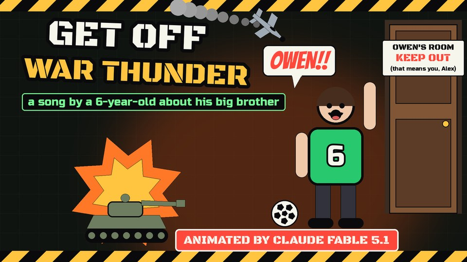

# Get Off War Thunder

[](https://youtu.be/YMrcah4HFtQ)

**▶ [Watch it on YouTube](https://youtu.be/YMrcah4HFtQ)** · one of the [earlier videos](../../README.md#earlier-videos), made with Claude Fable 5.1

> Owen! Get off War Thunder! You've got a little brother! 🎮 A bouncy pop-punk song my six-year-old, Alex, wrote with me about his big brother, who has been playing "one more match" for 47 days.

## What you see

The whole song is a game: *Little Brother Simulator*, a military-sim HUD with a radar sweep in the corner, a match timer and a kill feed. The battlefield is our hallway. Alex (jersey #6) knocks on a door that says OWEN'S ROOM, KEEP OUT (that means you, Alex), the HUD scans the target (OWEN, AGE 12, STATUS: AFK, headset on), and out back the backyard reads PLAYERS ONLINE: 1.

In the chorus "OWEN!" slams onto the screen between hazard stripes as LITTLE BROTHER DETECTED, the plane spirals down with a MAYDAY and the tank blows up like a cartoon. Verse two is the squad chat ("hold on bro, I'm unlocking a new tank"), Alex's Spotter Guide (the big one, the one with two guns, the sneaky one) and Alex's Offer, a very generous deal where Owen gets to be captain. The bridge counts the matches while the sun goes down, until INCOMING: MOM, THREAT LEVEL: MAXIMUM. Final chorus, confetti, PAUSED. The last scene is the backyard at sunset: captain Alex, goalie Owen, and QUEUE POSITION: #2, estimated wait: "one more match".

## The code

| File | Lines | What it is |
|---|---:|---|
| [`render.py`](render.py) | 1,312 | The whole 16:9 video: the HUD, every scene, the kid figures, the tank and the plane, the kill feed and the word-by-word lyric band. The lyric timings are written into it. It also renders a single frame, a frame range or the thumbnail. |
| [`vertical.py`](vertical.py) | 154 | The three 9:16 Shorts, drawn by reusing `render.py`'s scenes in a vertical layout with big lyrics. |
| [`cover.py`](cover.py) | 79 | The YouTube cover: the tank exploding, Alex yelling, the KEEP OUT door. |
| [`audio_feats.py`](audio_feats.py) | 45 | Tempo, beat phase and per-frame loudness from the song, for the beat pulse and the effects that react to the music. |
| [`asr.py`](asr.py) | 30 | Speech recognition on the vocals (Parakeet TDT through sherpa-onnx) to time every word. |
| [`mux_shorts.py`](mux_shorts.py) | 13 | Puts the song back on the three silent Short renders, with short fades. |

That's **1,633 lines** of Python, standalone (it was made before [`studio/`](../../studio)), drawn with Pillow. [`lyrics.txt`](lyrics.txt) has the lyrics; [`NOTES.md`](NOTES.md) has how it was made and the exact commands.

## By the numbers

- 2:01 long, 6,946 frames rendered at 30 fps (3,617 for the 16:9 video, 3,329 for the three 9:16 Shorts), about 153 BPM
- 42 lyric lines and 281 words synced to the vocals
- 3 Shorts cut from it

## Render it

```bash
cd songs/get-off-war-thunder
# needs the song as song.wav and the five fonts in fonts/ (see NOTES.md)
ffmpeg -v error -y -i song.wav -ac 1 -ar 16000 song16k.wav && python3 audio_feats.py
python3 render.py frame 33 frame.png
```

---

Song, lyrics and concept by aditazzz and Alex. Video by Claude Fable 5.1: every frame is rendered from the code in this folder. The code is MIT-licensed; the song, lyrics and artwork are all rights reserved ([details](../../LICENSE-CONTENT.md)).
