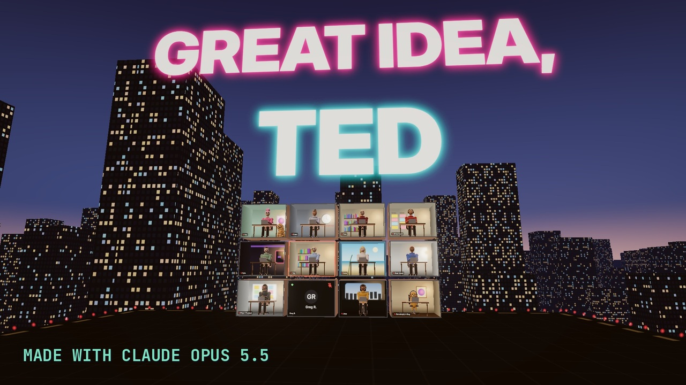

# Great Idea, Ted

[](https://youtu.be/i9R1D2cdrT4)

**▶ [Watch it on YouTube](https://youtu.be/i9R1D2cdrT4)**

> Tuesday, ten o'clock. I said "we should push the launch." Nobody wrote it down. Eight minutes later Ted said it, word for word, and the room gave him a raise.

## What you see

A 3D film set in the city from [I have a blocker.](../i-have-a-blocker), with the same cast. The meeting is twelve
video-call rooms floating over the city at blue hour, and the sky slowly darkens as the meeting drags on. The tower clock
says 10:00, the meeting notes say Untitled, 0 words, Tom is on his phone with his cat on the desk, and on "let's circle
back" the rooms swing out of the grid into a circle. Eight minutes later the clock says 10:08, verified, and Ted's room
slides out of the grid.

The choruses turn the city gold: the sky lights up, everyone claps, and the jokes go up on billboards. Ted's raise
(whose digits escape the letter and rain over the city by the second chorus), his face on the leadership page, an equity
grant, a conference room named after him. On "Unless." the party stops and every room goes dark except mine. Then the
receipts: the official minutes, the notes doc with my sentence in it, the font menu at 32 point, the file name
`my idea, do not rephrase, v7, final` in neon across the sky, an envelope from me to me, a gold 1st ribbon on Thursday,
the box of the good donuts (raspberry, powdered sugar, a bite out), and the meeting log: 9:04, me, we should push the
launch. In the end the sky itself answers back (HE REPEATED MY SENTENCE), a pie chart explains why it worked when Ted
said it, and the spreadsheet `who_said_it_first.xlsx` floods red. Ted is red.

Every joke is built into the city (billboards, signs, neon, cards beside the rooms), not pasted on top, and an automatic
check looked at every frame for props or people passing through each other.

(Ted is invented, and honestly he's a nice guy. Every company, app and person on screen is invented.)

## The code

| File | Lines | What it is |
|---|---:|---|
| [`web/js/look.js`](web/js/look.js) | 679 | The film. `renderTime(t)` draws the frame at time `t`, deterministically: the renderer and bloom, the twelve rooms over the city, a shot list of 92 shots cut to the vocal (each with its camera, what's on screen and who looks how), the sky darkening through the meeting, and `window.qa`, the collision check every frame runs through. |
| [`web/js/boards.js`](web/js/boards.js) | 550 | Every joke and text frame, built into the city: billboards, sky titles in neon, the raise letter and its escaping digits, the leadership page, the equity grant, the notes, the deck, the envelope, the donut box, the meeting log, the org chart, the plaques and the spreadsheet. One design system: warm paper and indigo ink, coral for Ted, mint for me. |
| [`web/js/mannequin.js`](web/js/mannequin.js) | 331 | The cast: smooth clay mannequins posed with two-bone IK (give each hand a target), faces with expressions, and the pets: my goldendoodle beside my desk and a cat loafing on Tom's. |
| [`web/js/rooms.js`](web/js/rooms.js) | 255 | The meeting: open-fronted diorama rooms, one per square on the call, each with painted walls, a desk, a laptop and its person. |
| [`web/js/city.js`](web/js/city.js) | 140 | The city at blue hour: towers of lit windows, street lights in rows and the roof the meeting floats over, all painted (unlit) geometry so it renders fast, and the time of day that darkens as the meeting goes on. |
| [`web/js/lib.js`](web/js/lib.js) | 98 | Shared helpers: easing, seeded randomness, clay materials with a rim light, canvas textures, fonts. |
| [`web/render.mjs`](web/render.mjs) | 40 | The renderer: serves the film to headless Chromium and writes stills or silent video chunks, on the GPU (`GPU=1`, Metal on a Mac) or on the CPU. |
| [`web/qa.mjs`](web/qa.mjs) | 20 | Runs the collision check on chosen shots and prints every contact (millimetres, which part, which solid). |
| [`web/sweep.mjs`](web/sweep.mjs) | 18 | Tunes a pose against the collision check: tries a grid of hand positions and reports which one leaves nobody touching their desk. |
| [`clips/render_master.sh`](clips/render_master.sh) | 12 | The YouTube master: the whole song at 2560×1440 on the GPU in six chunks, three at a time, with the check on every frame. |
| [`clips/make_overlays.py`](clips/make_overlays.py) | 24 | The subscribe pill and the end card, drawn by the studio's own [`studio/core.py`](../../studio/core.py) as transparent PNGs, so they go on top of the clean 3D master. |
| [`clips/assemble.sh`](clips/assemble.sh) | 17 | Joins the six chunks, lays the pill and the end card on top and adds the song. |
| [`web/look.html`](web/look.html) | 3 | The page the renderer opens. |

The timing data is in [`web/data/`](web/data): every sung word (`timed.json`), the beats and the song's sections.

## By the numbers

- 4:27 video, 8,007 frames rendered at 2560×1440, every one checked for collisions
- 2,093 lines of scene code, 92 shots, each reviewed and approved frame by frame
- 117 lyric lines synced to the vocal; captions go on YouTube as subtitles, nothing burned into the picture
- 12 rooms, 1 Ted

## Render it

```bash
cd songs/great-idea-ted/web            # copy the fonts into web/fonts/ first (see assets/fonts/README.md)
npm install && npx playwright install chromium
node render.mjs stills 1600 900 ../build/stills 34 120 248      # three stills (CLEAN=1 leaves the captions out)
node qa.mjs                                                       # the collision check
cd ../clips && ./render_master.sh                                 # the master, on the GPU
python3 make_overlays.py 2560 1440 && AUD="<the song>.wav" ./assemble.sh
```

The audio isn't in this repo; the timing data derived from it is.

---

Song, lyrics and concept by aditazzz. Video by Claude Opus 5.5: every frame is rendered from the code in this folder.
The code is MIT-licensed; the song, lyrics and artwork are all rights reserved ([details](../../LICENSE-CONTENT.md)).
