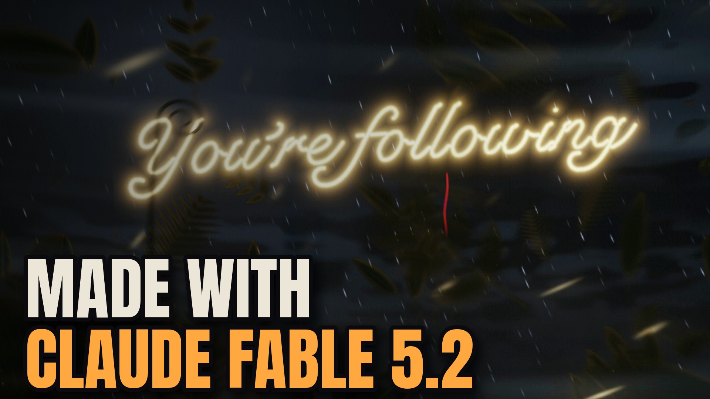

# It's Written

**▶ [Watch it on YouTube](https://youtu.be/lnWeyz6bQwY)**

<!-- model: Claude Fable 5.2 -->

> A walk across the night desert, inspired by The Alchemist. Every step lights the sand, the trail writes itself, and the road turns out to have been there all along. Maktub: it is written, and you still have to walk it.

## What you see

The whole film is one gold line. It starts as the glow under her feet, and it keeps turning into whatever the song is
about: a drawing in the sand, handwriting, a rail she rides, words in the sky. It's a spiritual song, so the film is
built from light and sand and a red thread, and three rides that each get bigger than the last.

- **A dream, a wind, a road (0:00):** a faceted grain falls onto moonlit sand and a ring of gold runs out through the ripples on the first hit. At 0:20 her shoe lands on the line.
- **The camel driver (0:31):** the line draws a camel lying down and its driver. His finger writes "It's written" as it's sung, then he puts his head on his arm and falls asleep, and the drawing blows away.
- **Forty days (0:39):** tally marks scratched along the line in groups of five, days counted under the same horizon.
- **The first ride (0:50):** the line lifts into a glowing ribbon and she slides down it, arms out. Then "It's written" burns into the sand in her hand, and the camera pulls out until her line crosses North Africa on the planet.
- **Every wrong turn (1:07):** one line draws each loss: a money bag that becomes a shop, a year as a ring of moon phases, one caravan missed and the next one caught. Then all of it folds into the letters of "It's written", with the shop and the camels still inside the word.
- **The second ride (1:16):** the handwriting unravels into a rollercoaster of light down the dunes, with a loop overhead and her face under the LOVE hat, singing.
- **Inside the grain (1:28):** she dives into a footprint and comes out in a night jungle made of light, a river of gold seen from above. The answers write themselves in the dark as they're sung: "Don't know", "Not yet", "You're following".
- **The wind (1:51):** she opens her arms on a crest and the wind takes her down the dune, then the camera rides the red thread alone over the crests and through the palms.
- **Just passing through (2:02):** horsemen on the ridge, the caravan halted, a walled oasis with palms and tents, a lantern with robed company, other caravans going by.
- **Written in the stars (2:20):** she walks out of the oasis gate, the sand lifts and writes "It's written" across the Milky Way in the same hand, and the biggest ride goes up into the stars and plunges down toward a well.
- **Someone at the well looks up (2:39):** she looks down into the water and her own face looks back. An owl's reflection opens its wings above her hat like a crown, and a tree of gold light grows inside it. It ends on that picture, not on black.

## The code

The film is code I made with Claude and Codex. The desert is Codex: Blender scenes built and
animated from Python, plus a small C++ renderer for the macro sand, the sky and the stars, called from Python. The world
inside the grain is Claude Fable 5.2: one WebGL2 fragment shader rendered frame by frame in headless Chrome. My character's
two hero shots are Claude Fable 5.2 in Blender, on the same rig and look as my Rate Limited video. Claude Opus 5.5
directed. Every frame is a function of the film frame number, so a move lands on the sung word it
belongs to, and all of it rendered on my MacBook.

This folder holds the final passes. The film was built in layers (rough cuts, look tests, earlier passes these files
import from), and those stay in the studio, so read this as the recipe rather than something that runs on its own. The
rig, the character's look files, the textures and the song aren't here either.

<!-- excerpt: desert/story/ink.py series -->

| File | Lines | What it is |
|---|---:|---|
| [`desert/story/ink.py`](desert/story/ink.py) | 119 | The drawings: hand-drawn contours animated along their arc length on the actual dune surface, the way a finger would draw them. The camel and its driver, the tally, the money bag and the shop, the moons and the caravans. |
| [`desert/story/rails.py`](desert/story/rails.py) | 369 | One pen stroke seen on a slip face, lifted through the air into a rail she rides, and carried up between the stars. |
| [`desert/story/passages.py`](desert/story/passages.py) | 318 | The driver's camp, the tally, the three losses and the settlement behind the wall, each keyed to its lines. |
| [`desert/story/world.py`](desert/story/world.py) | 164 | The exterior stage: terrain, ink and rider on one metre grid, and smooth camera keys on the song's time axis. |
| [`desert/story/camp.py`](desert/story/camp.py), [`camp_travellers.py`](desert/story/camp_travellers.py) | 445 | The oasis camp: woven tents, raked earth walls, date palms, and the robed company in the lamp light. |
| [`desert/story/water.py`](desert/story/water.py) | 143 | The well: the owl and the last push in through the surface of the water. |
| [`desert/story/conform.py`](desert/story/conform.py) | 205 | The edit: the song cut in exact frame ranges, and the master muxed from the song's first sample. |
| [`desert/finish/picture.py`](desert/finish/picture.py), [`film.py`](desert/finish/film.py), [`sand.py`](desert/finish/sand.py), [`queue_finish.py`](desert/finish/queue_finish.py) | 864 | The finishing pass: the cut's frame table, developing every plate in its kept camera, wind-laid quartz under the pen shots, and the resumable render queue that keeps verified sections on disk. |
| [`desert/render.cpp`](desert/render.cpp) and its headers | 828 | The C++ renderer: dune, hummock and ripple terrain, footprints, sand grains up close, the desert sky and the stars, and the travellers' meshes. |
| [`desert/rough/stage.py`](desert/rough/stage.py), [`physical.py`](desert/rough/physical.py) | 866 | The Blender Cycles stage the walk, the wind, the oasis and the well share, and the serial frame render. |
| [`desert/blender_pass.py`](desert/blender_pass.py), [`grains.py`](desert/grains.py) | 176 | The night sky with its long horizon of dust, and a tiled bed of rounded, chipped mineral grains. |
| [`inner/sky2.frag`](inner/sky2.frag), [`sky2_page.js`](inner/sky2_page.js), [`sky2_render.mjs`](inner/sky2_render.mjs) | 1101 | The world inside the grain: a night jungle seen as light, one flight down a river of gold, through the canopy and out on the wind, with the sky's answers written in it. The shader, its WebGL2 pipeline (motion-blur samples, bloom, tone map) and the resumable headless render. |
| [`hero/hero.py`](hero/hero.py) | 498 | My two hero shots in Blender: her face on the ride and the well looking up. She's built once, then every frame sets the rig's head, eyes and face, with the hat riding the head and the hair carried by the wind. |

The song's timing is in [`build/`](build/): every word's time measured on the vocal (`timed.json`), the beats and the
sections.

## By the numbers

- 3:08 long, 5,628 frames at 30 fps, finished at 1920×1080, all rendered on my MacBook
- 38 lyric lines, 248 words synced to the vocal
- 3 rides, each bigger than the last
- "It's written" written 4 times: by the camel driver, in the sand, out of the losses, in the stars
- 1 owl

## Credits

Character rig: Rain Rig (c) Blender Foundation | cloud.blender.org, modified. Milky Way: ESO/S. Brunier (CC BY 4.0).

Song, lyrics and concept by aditazzz, made with Suno and mastered through DistroKid (Mixea). The audio isn't in this
repo; the timing data derived from it is (`build/`).
