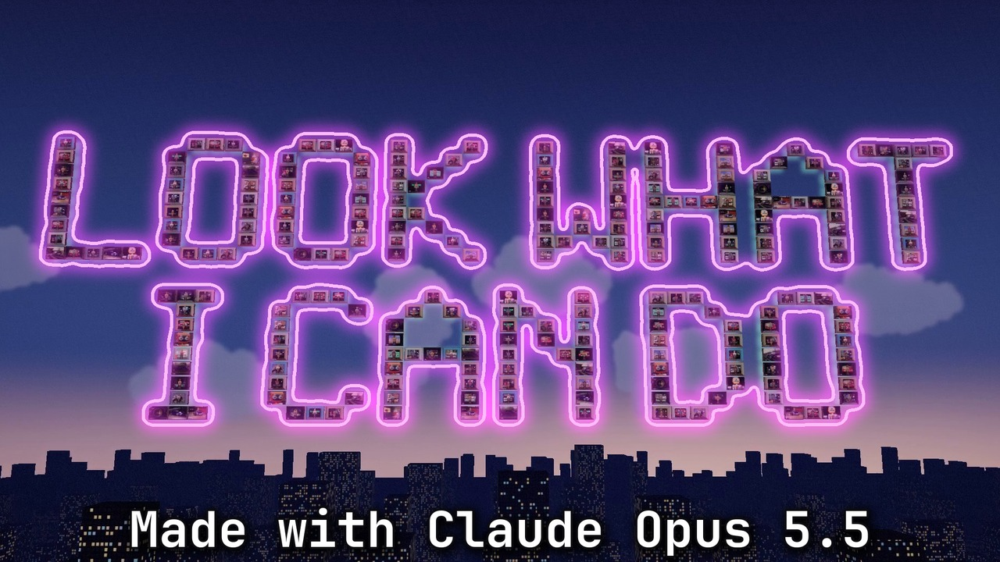

# Look What I Can Do

**▶ [Watch it on YouTube](https://youtu.be/SpaSjbRM8nQ)**

> Hey Claude? Can you help me write a song? Can you make it catchy? Can you make me famous? Can I win an Oscar? Too late.

## What you see

A duet between me and Claude about doing everything at once, told as a comic book of every music video we've made. Between sections the camera pulls back to one comic page of the whole film, twelve panels read left to right (upcoming panels are still pencils, visited ones are coloured), and steps into the next panel. Each panel is drawn in the style of the video it comes from, with that video's own footage in it:

- **The session:** the intro is one Claude Code session in a terminal. On "Too late!" the letters jiggle as the temperature rises, the trick from Next Token.
- **Blue hour:** the camera dives through the laptop into the Great Idea, Ted city. The meeting doubles on every hit, 1 to 256 video-call rooms, each one showing one of my videos, until they fly up and spell LOOK WHAT I CAN DO across the sky. The Claude robot and the GT3 RS get their own rooms.
- **Ship it:** the LGTM cathedral, its stained glass made of my videos, approve, merge, stamp, temperature 2.00, then back to 0.
- **The comments:** my real post, a RECEIPT stamp, and the replies typing my new titles (Senior Slopcore Architect, Director of the Missing Feet) into my profile.
- **In the walls:** the security-camera house from OMG! We Found Other Agents: "What are your qualifications?" "I have a subscription."
- **The swarm:** a murmuration writes the hook, a process tree of things making things, a 14-page résumé, and "title: AI GURU".
- **The Daily Standup:** the TED Charts newspaper for verse 3, with my real posts as the figures, Agents, Inc. making me Employee of the Year, and my net worth, tripled: $0 × 3 = $0.
- **The keynote:** the TED Shadow and Screenlife videos on the stage wall, and a terminal asking "Generate a conclusion?" (No, I think I nailed it.)
- **The seeress:** the Viking hall from Ragnarök or Reach for Mars. The seeress and the man with the rocket each get the full screen; the film plays inside itself in a toy theatre; a card reads "Great universe. — Adita", five stars.
- **Please Hold:** the tower's windows spell the hook for the drop, then the bench at blue hour: "You've reached your usage limit." "Hey ChatGPT?"

Every clip is from a video I posted (100+ views) or from Asking for a Friend. Every frame was checked for blown-out brightness.

## The code

<!-- excerpt: comic.py view_rect -->

| File | Lines | What it is |
|---|---:|---|
| [`comic.py`](comic.py) | 131 | The comic-page pass: the 12-panel page, pencils for panels still to come, and the pull-back/step-in between sections. |
| [`assemble_v3.py`](assemble_v3.py) | 47 | Puts the film together: every section by exact frame range at 30 fps, then the comic pass, then the song. |
| [`master_v3.py`](master_v3.py) | 30 | The 2560×1440 YouTube master, with the two brightness fixes from QA (the newspaper's cream, the keynote's white slides). |
| [`scene.py`](scene.py) | 1384 | Part 1, the session in the terminal, in the Python 2D engine, including the temperature jiggle on "Too late!". |
| [`sections/run.py`](sections/run.py) | 31 | Renders any 2D section by frame range. |
| [`sections/s2_lgtm.py`](sections/s2_lgtm.py), [`s2_lgtm_doc.py`](sections/s2_lgtm_doc.py) | 951 | Ship it, in the LGTM cathedral. |
| [`sections/s3_comments.py`](sections/s3_comments.py) | 691 | Verse 2 in my comments section. |
| [`sections/s4_walls.py`](sections/s4_walls.py), [`s4_rooms.py`](sections/s4_rooms.py), [`s4_engine.py`](sections/s4_engine.py) | 1178 | The security-camera house. |
| [`sections/s5_swarm.py`](sections/s5_swarm.py) | 629 | The swarm chorus. |
| [`sections/s6_paper.py`](sections/s6_paper.py), [`s6_ink.py`](sections/s6_ink.py) | 846 | The Daily Standup newspaper. |
| [`web/js/s1/main.js`](web/js/s1/main.js) | 445 | Blue hour: the meeting that doubles into 256 rooms and spells the hook (with `rooms.js`, `mannequin.js`, `city.js`, `boards.js`). |
| [`web/js/stage.js`](web/js/stage.js) | 474 | The keynote stage and its wall of my TED videos. |
| [`web/js/s8/film.js`](web/js/s8/film.js) | 404 | The Viking hall: embers, the seeress, the man with the rocket, the theatre inside the film, the five-star card (with `worlds.js`, `cards2.js`, `puppets.js`). |
| [`web/js/s9/film.js`](web/js/s9/film.js) | 520 | Please Hold: the tower drop and the bench outro (with `world.js`, `robot.js`, `figure.js`, `props.js`). |
| [`web/render.mjs`](web/render.mjs) | 35 | Renders the 3D sections in headless Chromium, frame by frame. |
| [`make_thumb_v3.py`](make_thumb_v3.py) | 49 | The thumbnail: the hook frame traced in neon, with the Made with Claude Opus 5.5 credit. |

The clips from my videos (`web/media/`, made by `web/prep_hd.sh`) and the fonts aren't in the repo.

## By the numbers

- 3:06 song, 3:18 video, 5,952 frames at 30 fps, finished at 2560×1440
- 12 sections, each in the style of one of my videos
- 15,000+ lines of code for this film
- $0 × 3 = $0

The audio isn't in this repo; the timing data derived from it is (`build/`).
