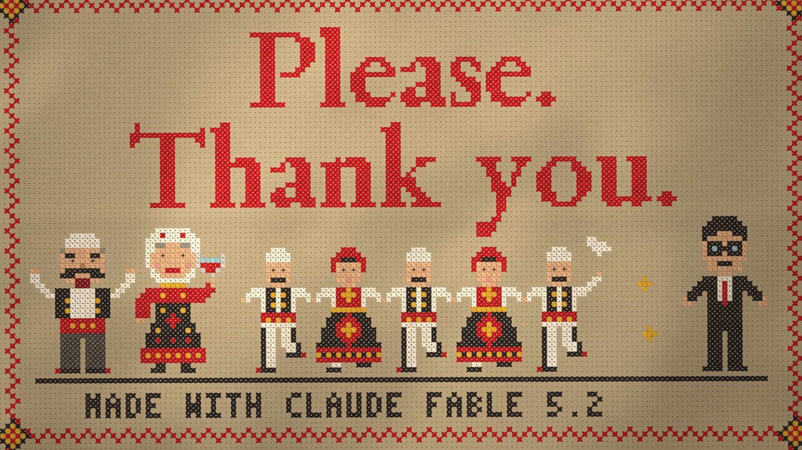

# Prompt Engineer (Stitch by Stitch)

[](https://youtu.be/3i7nwTkjgzs)

**▶ [Watch it on YouTube](https://youtu.be/3i7nwTkjgzs)**

<!-- model: Claude Fable 5.2 -->

> A music video drawn as one embroidered cloth, stitched while you watch. He says please to the computer, his uncle yells at it in all caps, and Mama has been writing clear instructions for thirty years.

## What you see

The song is about a guy who says please to the computer, an uncle who yells at it in all caps, and a mother who has been
writing clear instructions for thirty years. The film treats the whole song as a folk sampler: one cloth, nine panels,
and a needle that stitches each one in while you watch.

- **One cloth.** Everything is stitched onto the same piece of fabric: the morning chat, the wedding, the kitchen, the toast to Mama. The camera travels over it, and every picture is stitched in cross by cross as it's needed.
- **The dancers.** A line of folk dancers joins on the beat and never stops, and the border around the cloth marches on every beat.
- **The words.** Lettering gets stitched in on the sung words, and the needle follows whatever is being stitched.
- **The back of the cloth.** On the choruses the camera flips the cloth over: a knotted tangle of thread. Nobody knows how it works, but the magic words work.

Claude got the song, the lyrics and one night to make it, with no references, and then we spent a day fixing what a
viewer would notice. All of it is code I made with Claude.

## The code

Everything is a pure function of time: `film.render(t)` returns the 1920×1080 frame for second `t`, so any frame can be
rendered on its own, in any order, on any number of processes.

<!-- excerpt: film.py render -->

| File | Lines | What it is |
|---|---:|---|
| [`film.py`](film.py) | 1854 | The film: the nine panels, the timeline (beat times from `beats.json`, about 136 BPM), the camera keys and the needle that follows whatever is being stitched. `python3 film.py still 66.2` renders a still; `python3 film.py fits` checks that every block of text sits inside its box. |
| [`engine.py`](engine.py) | 607 | The stitch renderer. The cloth is a 480×270 grid of cells, each holding a palette index plus the time it gets stitched and unpicked. A pre-rendered atlas of thread tiles (half and full cross stitches, per colour) is blitted per cell, then the cloth is warped through a camera (pan, zoom, roll, a little tilt), wrinkled, lit with a soft spot, and given depth of field and motion blur from the camera's own speed. Also the knotted back of the cloth and the needle. |
| [`figures.py`](figures.py) | 973 | The cast and props as stitch sprites, a few poses each, swapped on the beat like stop motion. |
| [`art.py`](art.py) | 355 | Lettering (two pixel fonts for small text, TrueType rasterised to stitches for display lettering), reveal orders (by column, row, ring, random, or word by word on the vocal), kilim borders and motifs. |
| [`render_all.py`](render_all.py) | 39 | Renders the whole film in resumable chunks across processes and joins them frame-exactly. |

[`beats.json`](beats.json) holds the song's tempo, beats and downbeats, measured from the audio. Fonts in
[`fonts/`](fonts/): Anton, EB Garamond, Cormorant Garamond and Playfair Display SC, all under the SIL Open Font License.

## By the numbers

- 3,828 lines of Python: a cross-stitch renderer and the film on top of it
- 7,547 frames at 1080p, 30 fps, rendered on my MacBook
- One cloth, nine panels, a border that marches on every beat

## Render it

You need Python 3 with `numpy`, `opencv-python` and `pillow`, and `ffmpeg` on the path. The song's audio isn't in this
repo: `render_all.py` expects a `source.wav` next to it for the final mux (the picture renders without it).

```bash
cd songs/prompt-engineer
python3 film.py still 66.2              # one frame, into scratch/
python3 film.py fits                    # every block of text inside its box
python3 render_all.py film.mp4 8        # the whole film on 8 processes (resumable), muxed with source.wav
```

Song, lyrics and concept by aditazzz.
