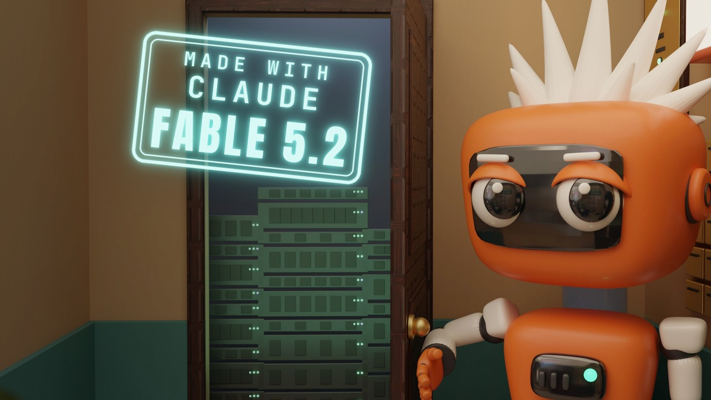

# Rate Limited

[](https://youtu.be/L7ipxNqJhKc)

**▶ [Watch it on YouTube](https://youtu.be/L7ipxNqJhKc)**

<!-- model: Claude Fable 5.2 -->
<!-- excerpt: screens/phone_real.py chat_screen -->

> It's 2 a.m. and Claude is the night super of the apartment building inside my laptop. Quiet hours are 10 PM to 6 AM, and the sign means me. I spend the night scheming to get back in; he spends it dimming the lights, checking my stories and telling me to close the laptop and drink some water. He doesn't get tired. He'll be here at six.

## What you see

The same song as the [first Rate Limited video](../rate-limited), made again from scratch. A usage limit, told as a
building with a night superintendent who is only doing his job.

- **The lobby:** Claude, the small orange robot, behind the glass of his door with a 429 paddle, a QUIET HOURS notice
  and a neon sign over the desk. He's calm and kind the whole way through. The limit is the system's, not his.
- **Her side:** a bright apartment, Cooper the doodle, a cat draped over the top of every screen she sits at. She
  never begs. She schemes: a note slid under the door, messages he's read at 3:59 and isn't allowed to answer, a
  forearm stand back to back against his door during the countdown.
- **Real screens:** every phone, laptop and app on screen is drawn to look like the real interface (messages,
  stories, the Claude app, a terminal), with the timing of each tap and scroll on the song.
- **The other model:** in the third verse she goes out with a different robot, who puts her on hold.
- **4:41 a.m.:** robe, sheet mask, a vibration plate, and the TV news showing a real headline, word for word, with its
  source and date. Then the party comes out of the TV.
- **6:00:** the sunrise comes down the building a floor at a time, he unlocks the door, and the purple car with yellow
  brakes is waiting at the curb.

## The code

The picture is two layers. The characters and sets are 3D, rendered in Blender (Cycles, on my MacBook) as stills and
short frame ranges; she is built on Blender Studio's Rain rig, modified (Rain Rig © Blender Foundation |
cloud.blender.org, CC BY 4.0). Everything that makes those renders a film is in this folder: React (Remotion) puts
them on a stage, moves the camera across them, cuts on the beat grid, draws the screens, clocks, neon and type, and
grades the final, with every frame a pure function of the song's time. The phone and laptop screens that sit inside
the 3D frames are drawn in Python.

The Blender files, the renders (about 3.7 GB of plates), the fonts and the song aren't in the repo, so this folder
shows how the film is put together rather than rebuilding it end to end.

| File | Lines | What it is |
|---|---:|---|
| [`remotion/src/shots/c7/kit/edit.tsx`](remotion/src/shots/c7/kit/edit.tsx) | 1716 | The final cut: 61 blocks over the whole song (`c7/`), each a stretch of renders with its own camera (`kit/cam.ts`, `SliceCam.tsx`), transitions (`trans.tsx`), the little life in each set (`life.tsx`), and the edit layer that holds a frame where a render smeared and grades a few ranges (`edit.tsx`). |
| [`remotion/src/Film.tsx`](remotion/src/Film.tsx) | 422 | The film's shell: every shot on its own frames, one 2560×1440 stage reframed for 9:16 around each shot's centre, the caption layer kept separate and off (with `timing.ts`, `theme.tsx`, `ease.ts`, `Root.tsx`, and `FitProbe.tsx`, which measures every text box against its container). |
| [`remotion/src/blocks/real/MobileApp.tsx`](remotion/src/blocks/real/MobileApp.tsx) | 1183 | The real-looking interfaces in React: the phone, a chat app, stories, a usage page, a search, a terminal (with `Phone.tsx`, `ClaudeChat.tsx`, `ClaudeCode.tsx`, `Stories.tsx`, `UsagePage.tsx`, `ChatSearch.tsx`, `script.ts`). |
| [`remotion/src/blocks/Plate.tsx`](remotion/src/blocks/Plate.tsx) | 646 | The building blocks: a still as a plate with a camera move and depth layers, a screen insert pinned to the plate, neon and type that fit their boxes, analog and digital clocks, light changes, the caption layer. |
| [`remotion/src/shots/first30/S1AB.tsx`](remotion/src/shots/first30/S1AB.tsx) | 2410 | The first 30 seconds, worked on harder than anything else: the street, the door, the neon, the clocks (`street.tsx`, `door.tsx`, `kit.tsx`). |
| [`remotion/src/shots/s03/seca.ts`](remotion/src/shots/s03/seca.ts) | 4474 | Every section of the song shot by shot as it was in cut 4 (`s03/` to `s13/`). The final plays some of these pieces inside its blocks. |
| [`remotion/src/shots/c5d/index.tsx`](remotion/src/shots/c5d/index.tsx) | 3287 | Cut 5, where shots were merged and re-timed (`c5/`, `c5d/`). Kept because later cuts still import from it. |
| [`remotion/src/shots/index.ts`](remotion/src/shots/index.ts) | 806 | The shot registry and the shared pieces between cuts (`l2data.ts`, `l2kit.tsx`, `Animatic.tsx`, `types.ts`). |
| [`screens/phone_real.py`](screens/phone_real.py) | 3116 | The screens inside the 3D frames, drawn in Python with Pillow: a messages thread with typing dots, banners and the keyboard (`phone_real.py`), the laptop and watch (`devices_real.py`), the TV (`tv.py`), the door glass (`glass.py`), plus their runners and contact sheets. |
| [`remotion/tools/build_data.py`](remotion/tools/build_data.py) | 232 | Writes the shot list, beats and words the film reads (`src/data/`). |
| [`tools/slice_plate.py`](tools/slice_plate.py) | 320 | Cuts a render into depth layers for parallax (`slice_plate.py`) and checks that no shot sits still for too long (`motion_floor.py`). |

[`build/`](build/) has every word's time measured on the vocal (`words.json`) and the beat grid (`beats.json`).
[`remotion/README.md`](remotion/README.md) explains how a shot is added and the rules every shot follows.

## By the numbers

- 3:40 long, 6,612 frames at 30 fps, finished at 2560×1440, all rendered on my MacBook
- 74 shots in the shot list, cut into 61 blocks for the final
- About 18,700 lines of TypeScript and Python for this video
- 378 words synced to the vocal
- 1 superintendent, 0 glasses of water

## Render it

You need Node, ffmpeg, the fonts, and the renders in `remotion/public/plates/`, which aren't in the repo.

```bash
cd songs/rate-limited-fable/remotion && npm install
python3 tools/build_data.py
npx remotion render src/index.ts Cut7Film16x9 out.mp4 --muted   # the final, silent; mux the song with ffmpeg
```

---

Song, lyrics and concept by aditazzz. Video made in code with Claude Fable 5.2. The code is MIT-licensed; the song,
lyrics and artwork are all rights reserved ([details](../../LICENSE-CONTENT.md)).
