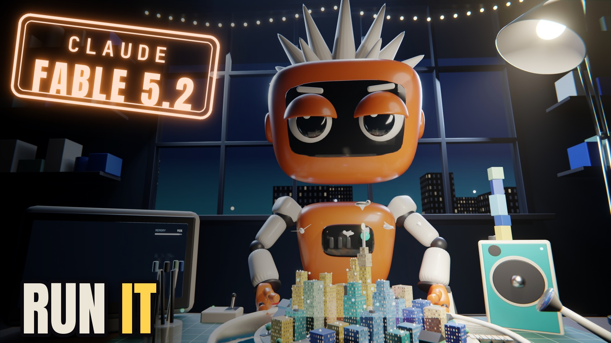

# Run It

[](https://youtu.be/Lq05czpkKKE)

**▶ [Watch it on YouTube](https://youtu.be/Lq05czpkKKE)**

<!-- model: Claude Fable 5.2 -->

> Every lyric in this song is a prompt. A pink dot becomes a city, the city gets a purple sports car with yellow brakes, gravity gets switched off, and Claude builds all of it by hand on a workbench at night. Then one more prompt breaks everything.

## What you see

Look What I Can Do, Part 2. The first song was me asking for more. This one is the session itself: a prompt bar at the
bottom of the screen, a memory meter in the corner, and every line I sing typed into it as a prompt.

- **New session (0:00):** a dark screen, a little pink dot in the middle that breathes on the kick, one red button nobody is supposed to touch. The first chorus is flat and loud: one dot becomes four, sixteen, a wall of variants, then one dot again.
- **The workbench (1:11):** on "Turn the dot into a city" the picture dissolves into the glass of a monitor, the camera pulls back, and it's a real desk at night. Claude, the small orange robot from Asking for a Friend, is building what I prompt as a miniature on a turntable, by hand. He's deadpan, half-lidded and never the one who gets it wrong.
- **Every prompt is a prop.** Rain on just one side is a watering can. The purple sports car is a toy set down with long tweezers, and a brush turns one caliper yellow on "brakes". A little guy goes in every window of the office block, and types twice as fast once he gets a coffee. The pigeons are paper, on threads from a rod he twirls. Gravity is a switch on the desk: everything loose floats, including him. He takes the car out of the air first and tapes it down.
- **Chorus two:** a strand of bulbs, a match for the candle on the tallest tower, a push on the turntable's rim, a metronome that makes the loose blocks hop, and a speaker whose knob goes all the way up. "Turn the bass into a tower": a block a beat jumps onto the speaker and stacks.
- **The bridge:** two paper moons that meet on "love" and get googly eyes on "weird". The ocean is a tray with a bath plug. Deleting Mondays is a week planner with Monday's column pulled off (pause on it: Monday has eight meetings). Moving the sun is the desk lamp. "Make it vertical for everyone" is him standing the whole island on its edge.
- **Out of memory (2:31):** everything stops, the status light goes amber, the monitor says not responding. The ending goes back to the flat screen: the broken world shrinks to a card in the history panel, shatters into the pink dot, the dot turns white, and the last five prompts are Undo, Undo, Undo, Perfect, Ship it.

Colour rules for the whole film: pink is only the dot, purple is only the car, orange is only Claude. Nothing strobes.

## The code

The film is two media. The opening and the ending are React (Remotion): flat vector pictures and the on-screen UI, every
frame a pure function of the song's time. The middle is a 3D scene in Blender, built and animated entirely from Python:
one script makes the set from primitives, one function per passage keys Claude, the props and the camera, and the Blender
frame number is the film frame number, so a move lands on the sung word it belongs to. All of it is code I made with
Claude, and all of it rendered on my MacBook.

Claude's rig and the car are appended from Asking for a Friend's Blender files, which are binaries and aren't in the
repo; neither are the fonts or the song.

<!-- excerpt: blender/wbfilm.py shot_porsche -->

| File | Lines | What it is |
|---|---:|---|
| [`blender/wbfilm.py`](blender/wbfilm.py) | 1315 | The workbench film: `build()` makes the scene, then one `shot_*` function per passage (25 of them) keys Claude, the props and that shot's camera for its own frame range. Also the monitor's prompt text, the rain and the float when gravity is off. |
| [`blender/wbset.py`](blender/wbset.py) | 380 | The set, by hand from bevelled primitives: the room and its window, the bench, the turntable with the island and its water tray, the city's blocks and their paint, the desk lamp, the watering can, the monitor, the lights and the compositor. |
| [`blender/wbprops.py`](blender/wbprops.py) | 359 | The small things he works with: tweezers, brush, traffic lights, the open office block (wallpaper, pendant lamps and a desk per floor), peg people, a coffee, paper pigeons, the GRAVITY switch, tape, the bulb strand, a match, metronome, speaker, the RUN button, moons, plug, week planner, clock. |
| [`blender/wb.py`](blender/wb.py), [`wbrig.py`](blender/wbrig.py) | 235 | Shared helpers (materials, lights, look-at) and the appends of Claude and the car; posing Claude's rig from world-space targets. |
| [`blender/run.py`](blender/run.py), [`jobs/blfilm.py`](blender/jobs/blfilm.py), [`jobs/blclip.py`](blender/jobs/blclip.py) | 68 | The job runner, the job that builds and saves the whole film scene (about 95 seconds) and renders stills at given film times, and the resumable frame render for any range of the film. |
| [`blender/jobs/blasm.py`](blender/jobs/blasm.py) | 51 | The assembly in Blender's sequencer: the Remotion opening, the dissolve into the workbench frames at 1:11, the cut back to the Remotion ending at 2:35, and the song. |
| [`blender/jobs/bllook.py`](blender/jobs/bllook.py), [`jobs/blcam.py`](blender/jobs/blcam.py) | 81 | Look-dev without a rebuild: lamp, roof paint, bloom and window variants rendered side by side, and camera candidates for one moment. |
| [`blender/jobs/blthumb.py`](blender/jobs/blthumb.py), [`jobs/blcover.py`](blender/jobs/blcover.py) | 68 | The thumbnail and album-cover stills: the moment he looks at us over the running city, with his eyes on the lens. |
| [`remotion/src/shots/hook/Hook.tsx`](remotion/src/shots/hook/Hook.tsx) | 715 | The first 41 seconds as one continuous picture: the dot, the red button, the canvas the camera zooms around on (with `anim.ts`, `overlay.ts`, `times.ts`). |
| [`remotion/src/shots/ch1/Ch1.tsx`](remotion/src/shots/ch1/Ch1.tsx) | 809 | Chorus one: flat maximalism, 1 to 4 to 16 to a wall of variants and back to one dot (with `palette.ts`, `times.ts`). |
| [`remotion/src/shots/final/Final.tsx`](remotion/src/shots/final/Final.tsx) | 546 | The reboot and the outro: the crashed world as a card in the history panel, the shatter into the dot, the white light, the Undos (with `world.ts`, `Car.tsx`, `overlay.ts`, `times.ts`). |
| [`remotion/src/RunIt.tsx`](remotion/src/RunIt.tsx) | 837 | The film's shell: the timeline of shots, the prompt bar that types each lyric on its sung onset, the memory meter and the REC clock (with `Timeline.tsx`, `timing.ts`, `theme.tsx`, `components/`), and `FitProbe.tsx`, which measures every text box against its container. |
| [`remotion/src/epic/world.ts`](remotion/src/epic/world.ts) | 891 | An earlier middle, one persistent three.js world (with `film.ts`, `Epic.tsx`). The workbench replaced it in the final cut; the ending still imports from it, so it stays. |
| [`remotion/src/shots/city/City.tsx`](remotion/src/shots/city/City.tsx) | 3174 | Earlier versions of the middle that aren't in the film either: the 2.5D city, the grey-box 3D stand-ins and their camera paths (`mid3d/`), the first crash (`crash/`) and the hero-shot test (`hero/`). |

The song's timing is in [`build/`](build/): every word's time measured on the vocal (`timed.json`), the beats and the
sections. `remotion/src/data/` holds the same data plus the shot list and the palette per section.
`remotion/src/vendor/pixelfx/` is a small part of pixelfx (MIT, see its LICENSE and NOTICE), used by the earlier middle.

## By the numbers

- 3:18 long, 5,940 frames at 30 fps, finished at 2560×1440, all rendered on my MacBook
- 2,542 of those frames are the 3D workbench: 25 shots from about 2,800 lines of Python
- 84 lyric lines, 376 words synced to the vocal
- 3 times Claude looks at the camera, 1 Monday deleted

## Render it

You need Blender 5.2, Node for Remotion, ffmpeg, the fonts (JetBrains Mono in `remotion/public/fonts/`), the song (as
`remotion/public/song.wav` and `build/audio/run_it_edit_v1.wav`), and the Blender file with Claude and the car that `blender/wb.py` appends from. Paths are
relative to the repo root.

```bash
B=/path/to/Blender                                                                   # Blender 5.2
$B -b -P songs/run-it/blender/run.py -- blfilm 100 64                                # build + animate the film scene, save film.blend
$B -b -P songs/run-it/blender/run.py -- blclip 70.6 155.34 100 64                    # the workbench frames (resumable)
cd songs/run-it/remotion && npm install
npx remotion render src/index.ts RunIt16x9 ../build/hero/mst4.mp4 --scale=1.3333 --muted --props='{"noAudio":true}'   # opening and ending at 1440p
cd - && $B -b -P songs/run-it/blender/run.py -- blasm 100 0 198 144 1                # assemble with the song
```

3D car model: "Porsche 911 GT3 RS (991.1) '16" by Mona x Supercars (sketchfab.com/Car2022), CC BY 4.0, modified
(repainted Ultraviolet, yellow calipers).

Song, lyrics and concept by aditazzz. The audio isn't in this repo; the timing data derived from it is (`build/`).
