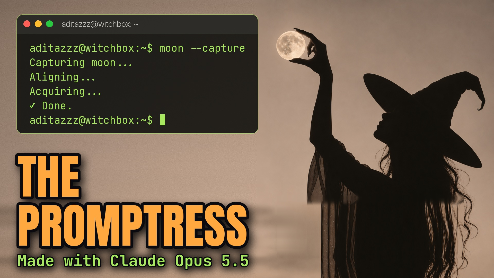

# The Promptress

[](https://youtu.be/TMT3tTQcfMo)

**▶ [Watch it on YouTube](https://youtu.be/TMT3tTQcfMo)**

> Abracadabra, autocomplete. A witch types a little line and the moon finishes it, until it starts finishing her. A Halloween song about AI: asking the machine for your future and finding out it was writing yours. 🌕

## What you see

Every moon in this video is one I photographed and filmed myself. The film opens on my real moon, fading up from the
dark, and on "once upon a midnight query" a speck crossing its face turns out to be a woman walking. The moon opens like
a door, the camera goes through my own clouds into a world inside it, and on the drop she takes the moon between her
fingers. From there the worlds live inside my shots: grandma's spellbook with pages that are windows, twenty moons for
"twenty tabs", a crescent she draws whose circle finishes itself, lunar phases rolling one per beat.

The choruses are commands. HEX, HEX splits the moon into its phases, EXECUTE fires, CLICK CLICK cuts hard to huge moons,
and CONJURE IT turns them into a lit door. In the second half the song turns over, and so does the film: the tarot cards
flip before her hand arrives, her reflection moves first, the second chorus is mirrored (the moon acts and she follows
late), and in the bridge her future pose is traced in light before she moves. On "then drew the line" a line crosses the
moon and everything above it goes dark. In the last chorus she vanishes mid-gesture and her duplicate finishes it, the
camera pulls back (inside a door, inside my moon, inside a card), and it all collapses into a blinking cursor. It ends on
my real moon again, with small moons typed beside it before she asks, and her terminal answering `wish --grant`: your
wish has been granted. Terms and conditions apply.

This one is a work in progress, and I posted it as one: it's the first time I put my own photos and footage into a
video, and I want to take the concept further.

## The code

| File | Lines | What it is |
|---|---:|---|
| [`poc/film.py`](poc/film.py) | 830 | The film: an edit decision list of 23 sections and about 50 shots, each a function of song time `t`, cut to the vocal and the beats. Renders any frame range or a set of stills. |
| [`poc/hero5.py`](poc/hero5.py) | 344 | The opening (0:04 to 0:33): the walk across the real moon, the moon-door opening, through the clouds, the moon taken in her fingers on the drop, then out through a moon into my sky. |
| [`poc/hero4.py`](poc/hero4.py) | 402 | The version of the opening that hero5 builds on: the portal move, the door, the push to her raised hand. |
| [`poc/film_kit.py`](poc/film_kit.py) | 290 | Shared pieces: my moon as phases, reflections, tarot cards, light traces, titles, the cursor and the film finish. |
| [`poc/portal.py`](poc/portal.py) | 302 | One continuous camera from the real moon into the world inside it and back out, so the whole scene sits inside my moon. |
| [`poc/portal2.py`](poc/portal2.py) | 255 | The portal with real parallax: the world inside has its own camera, and the figure on the moon's face becomes life-size faster than the moon grows. |
| [`poc/wkit.py`](poc/wkit.py) | 205 | The world kit: a procedural crater field in true perspective, my clouds as fog banks at different depths, my moon as the celestial objects. |
| [`poc/witch2.py`](poc/witch2.py) | 192 | The witch, up close: about 220 strands of hair, sheer chiffon from overlapping ribbons, a real hand, and rim light from the moon. |
| [`poc/witch.py`](poc/witch.py) | 167 | Her silhouette and rig as vectors, crisp from 18 px on the moon's face to 800 px in close-up. |
| [`poc/door2.py`](poc/door2.py) | 145 | The moon-door as a physical opening: depth and parallax inside, a stone lip, and light that spills onto our world. |
| [`poc/scenes.py`](poc/scenes.py) | 132 | The worlds as scenes with a camera, so transitions can move through them. |
| [`poc/terminal.py`](poc/terminal.py) | 97 | My terminal window from the cover photo (`aditazzz@witchbox`), typed on in the opening and the outro. |
| [`poc/witch_back.py`](poc/witch_back.py) | 91 | The witch from behind, walking toward and reaching into a door. |
| [`poc/hand4.py`](poc/hand4.py) | 62 | The close-up hand that holds the moon like a pearl. |
| [`poc/rf.sh`](poc/rf.sh) | 13 | One render pass: splits the missing frames into three chunks and renders them in parallel (resumable). |
| [`poc/chunk.sh`](poc/chunk.sh) | 8 | Encodes one 10-second chunk from the frames, with inline headers so the chunks join cleanly. |
| [`poc/assemble.sh`](poc/assemble.sh) | 7 | Joins the chunks without re-encoding and lays the song under them. |

My photos and footage of the moon (`assets/`) aren't in this repo, so the film doesn't render without them; the code
shows how every shot is built from them.

## By the numbers

- 4:28 song and video, 8,052 frames rendered at 1080p
- 3,514 lines of scene code, 23 scenes, every cut timed to the song
- 49 lyric lines; no lyric captions on screen (the only text is part of the picture: the ink and the terminal)
- Every moon in the video is from my own photos and footage

## Render it

```bash
cd songs/the-promptress
python3 poc/film.py build/film/frames --still 74.6,96.0     # two stills (needs my moon photos in assets/)
bash poc/rf.sh                                              # the frames, resumable: run it until it prints DONE
for k in $(seq 0 26); do bash poc/chunk.sh build/film/frames $k build/film/chunks; done
WAV="<the song>.wav" bash poc/assemble.sh                   # the audio isn't in this repo
```

---

Song, lyrics, concept, and the moon photos and footage by aditazzz. Video by Claude Opus 5.5: every frame is composited
and animated by the code in this folder. The code is MIT-licensed; the song, lyrics, photos and artwork are all rights
reserved ([details](../../LICENSE-CONTENT.md)).
